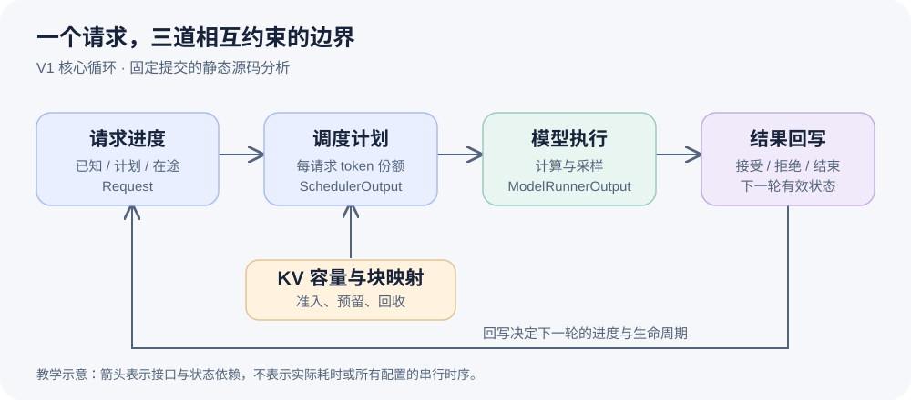

<div align="center">

# vLLM Design Notes

**从 token 进度，读懂推理运行时。**

以真实源码解释 vLLM 的调度、KV 管理、执行边界与工程取舍。


[开始阅读](#开始阅读) · [学习路线](ROADMAP.md) · [文章索引](index.json) · [内容约定](AGENTS.md)

</div>



## 关于项目

vLLM 持续接收不同长度的请求，组织它们竞争计算预算和有限的 KV 空间。读懂这个运行时，需要把调度计划、物理存储、模型执行和结果处理连成一个请求的生命周期。

本项目是一份持续积累的中文源码学习笔记。每组围绕三个相互关联的问题，用具体请求解释自然方案的限制、实现的关键洞察、状态不变量和工程代价。内容面向 LLM Serving、Inference Runtime 与 AI Infra 学习者；了解 Python、Transformer 和自回归生成，就可以从第一组进入。

每篇固定完整源码提交，提供准确的函数与行号链接，并给出下一步调试可观察的字段。当前文章属于静态源码分析；数值例子和机制图是教学示意，断点实验尚未执行，不作为 GPU 运行或性能证据。

## 开始阅读

先沿一个请求走过计划、资源与结果三个边界。它们共同说明，推理循环为何不能仅靠“组 batch 后调用模型”来理解。

| 顺序 | 文章 | 阅读后应能回答 |
| :---: | --- | --- |
| 01 | [prefill 和 decode 为什么能用同一套 token 进度调度](daily/2026-10-13/01-token-progress-scheduling.md) | 进度差怎样统一不同请求？computed 为什么可能含在途工作？ |
| 02 | [token 预算够用，为什么请求仍然进不了本轮](daily/2026-10-13/02-kv-capacity-admission.md) | 计算预算与 KV 容量有什么区别？分配失败怎样影响准入？ |
| 03 | [为什么模型算完以后，还必须回到调度器处理结果](daily/2026-10-13/03-output-state-reconciliation.md) | 采样、拒绝、取消和停止怎样修正下一轮状态？ |

## 阅读归档

| 日期 | 三个相连的问题 | 源码版本 |
| --- | --- | --- |
| 2026-10-13 | [token 进度](daily/2026-10-13/01-token-progress-scheduling.md) → [KV 容量准入](daily/2026-10-13/02-kv-capacity-admission.md) → [结果状态修正](daily/2026-10-13/03-output-state-reconciliation.md) | [`04c1f4a40796`](https://github.com/vllm-project/vllm/tree/04c1f4a407962a37d01b573f3a2aba91dd2ed3a9) |

## 学习路线

从统一 token 调度和 KV 容量约束进入，继续研究 continuous batching、chunked prefill、请求入口、前缀缓存与抢占，再沿输入整理、attention metadata、CUDA Graph 和异步调度进入执行侧。随后研究推测解码、多模态、KV connector、P/D 分离和分布式通信。[ROADMAP.md](ROADMAP.md) 说明这些问题怎样依次改变已有假设。

阅读时关注每个字段由谁创建、何时更新、谁仍在引用，以及何时可以回收。相同字段在同步和异步模式下可能具有不同边界，结论应结合文章的源码提交和配置条件理解。性能问题按“现象 → 指标 → 源码机制 → 实验 → 权衡”推进，不能从接口存在推出收益。

## 本地核验

GitHub 上可直接阅读。源码核验只需要 Git、uv 和包含指定提交的 vLLM checkout，不需要安装 vLLM 或模型依赖。

```bash
uv venv --python 3.12 .venv
export VLLM_SOURCE_DIR=../vllm
.venv/bin/python scripts/validate.py 2026-10-13
.venv/bin/python scripts/check_privacy.py --history
```

验证器检查当天恰好三篇、主题唯一、索引与正文一致、证据标记、固定源码链接及符号行号。隐私工具检查公开文件与可达提交的常见敏感模式，仍需人工审阅语境。发布器用 GitHub CLI 的既有认证，从 origin 识别目标仓库，推送后核对远端 main 与本地 HEAD；维护者使用 `.venv/bin/python scripts/publish.py YYYY-MM-DD` 发布完成的文章。

## 仓库结构与参与贡献

正文放在 `daily/`，机制图放在 `assets/`，`index.json` 记录主题、源码版本和证据定位。`scripts/` 提供正文核验、隐私检查与发布，新增或修正内容应遵循 [AGENTS.md](AGENTS.md)。

欢迎用 Issue 指出论证不清楚、源码定位错误或值得继续追问的问题。修正请附上文章、源码版本与证据位置；补充运行结果请提供配置、复现命令和真实观察。文章由 AI 辅助整理，源码定位检查通过不代表论证必然正确，仍需读者沿证据链审阅。本项目独立维护，学习来源为 [vLLM 的公开源码](https://github.com/vllm-project/vllm)，上游代码与文档引用保留各自出处。
