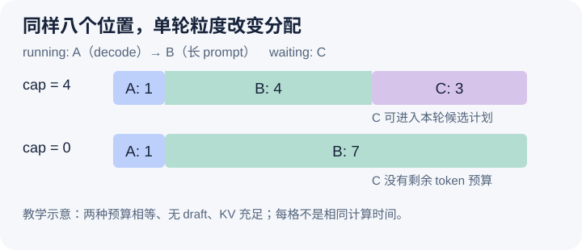

# 长 prompt 怎样分块，为什么仍然会挤占后来的请求

本文固定 vLLM 源码提交 `04c1f4a407962a37d01b573f3a2aba91dd2ed3a9`，属于静态源码分析。数值和机制图都是教学示意，没有执行调度实验或测量延迟。源码 checkout 中另有未提交的本地导读文件，本文没有将其作为固定提交证据。

昨天用进度差解释了一个请求能推进多少 token，今天进一步问：这些差额怎样分到同一轮？让 A 已在 decode，每轮需要一个输入位置；B 是已进入 running 的长 prompt，还差十个位置；C 刚带着三个 token 的短 prompt 到达 waiting。若只看“continuous batching”这个名字，很容易想象每轮都会先服务所有 decode，再把剩余空间均匀分给 prompt。但真正需要核对的是遍历顺序与每个请求的计算粒度，名字本身不保证任何一个请求的等待时间。

[running 遍历入口](https://github.com/vllm-project/vllm/blob/04c1f4a407962a37d01b573f3a2aba91dd2ed3a9/vllm/v1/core/sched/scheduler.py#L606)先扫描 `self.running`，之后才处理 waiting。B 做完第一块后仍留在 running，下一轮会从新的进度继续计算。因此“先处理 running”不等于“先处理 decode”：队列中也有尚未追完 prompt 的请求。若 B 在 A 前面且可用工作量足够大，它可能先消耗预算。源码还存在跳过某些 running 请求的条件，本篇例子假设顺序为 A、B，二者本轮均可执行，没有多模态、限流、推测解码或异步占位。

设本轮计算预算与输入预算都是八，KV 充足、活动请求上限至少为三，并启用 chunked prefill。[running 的粒度上限](https://github.com/vllm-project/vllm/blob/04c1f4a407962a37d01b573f3a2aba91dd2ed3a9/vllm/v1/core/sched/scheduler.py#L655)会在正的 `long_prefill_token_threshold` 小于差额时截断工作，然后再受剩余预算限制。如果 threshold 为四，A 分到一个位置，B 分到四个，剩余三个可供 C。若 threshold 为零，这个额外 cap 不生效，B 可以取剩余七个，C 本轮就没有机会。这里比较的是两个配置下的计划算术，不是实际运行数据，也没有证明四这个值更优。

图中两条横带具有相同的总宽度。上面的 B 只拿四格，于是后来者 C 能获得三格；下面的 B 拿七格，预算在到达 waiting 循环前已经用尽。A 的份额相同，差别来自 B 的单轮粒度。图没有画出模型执行时间，因为八个位置的计算成本还会随已有上下文、attention 和执行后端改变，不能将每格解释成相同毫秒数。

waiting 的工作量也不是先固定一大块再交给 runner。[候选预算计算](https://github.com/vllm-project/vllm/blob/04c1f4a407962a37d01b573f3a2aba91dd2ed3a9/vllm/v1/core/sched/scheduler.py#L1058)取剩余 token budget 与输入余量的较小者，然后依据命中或恢复进度确定还差多少位置。随后应用 threshold；[chunked prefill 的条件](https://github.com/vllm-project/vllm/blob/04c1f4a407962a37d01b573f3a2aba91dd2ed3a9/vllm/v1/core/sched/scheduler.py#L1101)决定候选工作量超过剩余预算时能否截成当前可承受的一块。不要将这条分支简化为对所有模型都保证“关闭分块必定一次算完整 prompt”：同一版本还有 threshold 的先行截断和模型配置处理，需要结合条件阅读。

两个预算相等只是本例的简化。[调度器初始化](https://github.com/vllm-project/vllm/blob/04c1f4a407962a37d01b573f3a2aba91dd2ed3a9/vllm/v1/core/sched/scheduler.py#L132)允许 `max_num_scheduled_tokens` 与 `max_num_batched_tokens` 不同。本轮还会为 drafting 考虑 `draft_slots`；[成功调度后的扣减](https://github.com/vllm-project/vllm/blob/04c1f4a407962a37d01b573f3a2aba91dd2ed3a9/vllm/v1/core/sched/scheduler.py#L800)让 token budget 减去本次安排数，而 input budget 减去安排数加 draft slots。这说明“还有 token budget”不能直接推出“还能增加输入行”。有 draft、encoder 或模型长度限制时，本篇的一维横带就需要扩展成多种约束同时成立的图。

分小块的洞察是把一个长请求的计算分散到多轮，使其他请求有机会插入；代价是 B 更晚完成 prompt，也可能多次经过调度与执行准备。更大的块则减少这类切分，却扩大一次占用。cap 不是完整的公平机制：它不预留未来每轮的 decode 份额，也没有证明 C 不会被不断到来的工作挤压。TTFT 与已有请求的 token 间隔是否改善，应在真实服务里控制到达过程和请求长度再测量，不能从本轮计划直接推出。

待执行的调试可以固定 A、B 的 running 顺序，在 threshold 为四和零时分别停在预算初始化、B 截断前后、C 准入前以及计划返回前，记录两个预算和 `num_scheduled_tokens`。若其他条件相同，B 的份额没有表现出相应截断，就要查配置是否真正生效；若预算尚有余量却没有 C，应继续看活动请求上限、KV 与等待状态。若把 B 移到 A 前面改变 A 的机会，就能直接反驳“running 优先等于 decode 优先”。本文没有执行这些断点，下一篇继续解释有余量时队首为何仍可能挡住 C。
