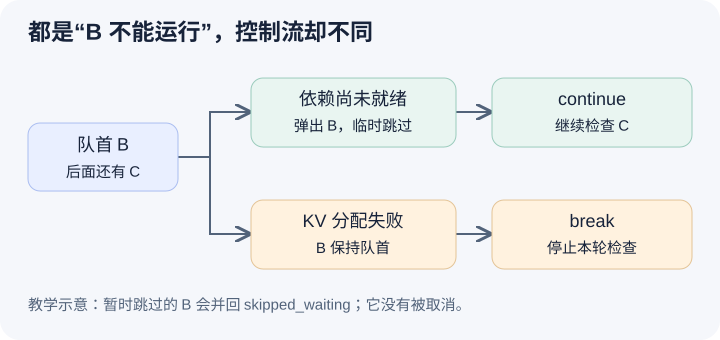

# 排在队首的请求，为什么有时被跳过，有时挡住后面的人

本文基于 vLLM 提交 `04c1f4a407962a37d01b573f3a2aba91dd2ed3a9` 的静态源码分析。请求状态、数值和图均为教学示意，没有运行请求或测量吞吐、TTFT。未提交的本地导读不属于本文源码证据。

把观察时点退到 B 的长 prompt 还没有进入 running。A 已取得本轮 decode 份额，waiting 中 B 排在短请求 C 前面。如果 B 当前不能运行，一个自然的优化是跳过去，先让 C 用剩余预算。这样能避免设备等待，但也可能让长请求不断被小请求绕过；更重要的是，“不能运行”有多种原因。等待语法编译、等待远端 KV、超过某种并行兼容性上限，与本轮资源装不下，是不同的控制条件。调度器必须明确何时继续扫描，何时停止这一轮准入。

[FCFSRequestQueue](https://github.com/vllm-project/vllm/blob/04c1f4a407962a37d01b573f3a2aba91dd2ed3a9/vllm/v1/core/sched/request_queue.py#L75)用 deque 保持队列操作；priority 队列则通过 Request 的比较关系组织堆。[Request.__lt__](https://github.com/vllm-project/vllm/blob/04c1f4a407962a37d01b573f3a2aba91dd2ed3a9/vllm/v1/request.py#L353)先比较 priority，再比较 arrival time，并有后续平局处理。数字更小的 priority 更靠前。这些代码回答的是候选谁先被检查，不保证候选一定进入执行计划，也不能单凭 FCFS 名称推断客户端输出严格按到达顺序完成。

V1 还有 waiting 与 skipped_waiting 两组候选。[队列选择](https://github.com/vllm-project/vllm/blob/04c1f4a407962a37d01b573f3a2aba91dd2ed3a9/vllm/v1/core/sched/scheduler.py#L2314)在 FCFS 下先选非空的 skipped_waiting，priority 下则比较两个队首。这样先前被暂时阻塞的请求仍有重新检查的入口，不能把 skipped 理解为已取消或永远降低优先级。每次选择仍是一次检查；是否能提升为可调度状态，还取决于异步依赖是否完成。

当 B 处在等待远端 KV 或语法编译的状态时，[_try_promote_blocked_waiting_request](https://github.com/vllm-project/vllm/blob/04c1f4a407962a37d01b573f3a2aba91dd2ed3a9/vllm/v1/core/sched/scheduler.py#L3010)先尝试恢复其状态。若依赖还没完成，[本轮遍历分支](https://github.com/vllm-project/vllm/blob/04c1f4a407962a37d01b573f3a2aba91dd2ed3a9/vllm/v1/core/sched/scheduler.py#L868)弹出 B，放入临时的 step_skipped_waiting，再 continue。这使 B 不会在同一轮被反复取出来，同时让 C 有机会被检查。LoRA 兼容性上限或尚未排空的可交付 stale output 也有相似的暂时跳过路径，但它们并不代表同一种资源问题。

图的上支路把 B 暂存后继续检查 C，下支路让 B 保持队首并结束当前遍历。两支路最终都保留 B，差别是 C 本轮能否被检查。临时跳过集合在循环结束后会[并回 skipped_waiting](https://github.com/vllm-project/vllm/blob/04c1f4a407962a37d01b573f3a2aba91dd2ed3a9/vllm/v1/core/sched/scheduler.py#L1327)，所以这不是将 B 丢出系统；prepend 的具体顺序还要结合 FCFS 或 priority 队列实现理解。

对容量失败，控制流却不同。[waiting 的 KV 分配失败分支](https://github.com/vllm-project/vllm/blob/04c1f4a407962a37d01b573f3a2aba91dd2ed3a9/vllm/v1/core/sched/scheduler.py#L1209)会 break，且成功后才弹出候选。因此 B 保持在原队首，C 本轮不再尝试。设剩余预算为四，B 的分块需要新 KV 块而无法分配，C 的短 prompt 恰好可能复用缓存，这条遍历仍不自动寻找 C。这是由源码可以推演出的队首阻塞例子，没有实际执行；它也不说明这种情形在真实负载中出现的频率。

类似地，当未允许分块且候选量超过本轮剩余预算，或对齐、编码器与 lookahead 约束把可安排量减到零时，waiting 的对应分支也可能停止扫描。改变 break 为 continue 看起来很小，却会改变准入排序、长请求等待和重算机会，还需要设计何时重试、怎样避免饥饿，以及缓存检查的副作用。本文描述现有取舍，没有修改上游代码，也没有把这个反例包装成已经确认的缺陷。

更外层还有[活动请求数限制](https://github.com/vllm-project/vllm/blob/04c1f4a407962a37d01b573f3a2aba91dd2ed3a9/vllm/v1/core/sched/scheduler.py#L857)：它把 running 与等待流式输入但仍占 runner 槽的会话一并计数。达到上限时，即使预算剩余也停止准入。running 表示已占有的一组请求，`num_scheduled_tokens` 表示本轮真正安排的子集，两者不能当成同一个 batch。多个约束分别作用在检查资格、工作量和物理存储上，才能解释为什么某个 C 没有出现。

待执行的验证可以在 FCFS 场景固定 B、C 的到达顺序，分别让 B 处于未完成依赖和 KV 分配失败状态，观察 request_queue、step_skipped_waiting、skipped_waiting 与 C 是否进入计划。前者应允许继续检查，后者应停在 B；如果后者实际上越过 B，应检查是否已走到其他分支或源码版本不同。随后解除依赖，验证 B 可以重新被检查而非消失。对 priority 再改变 B、C 的数值，区分候选顺序与实际准入。本文未运行这组观察，下一篇研究已经入选的请求为何还会被撤回。
