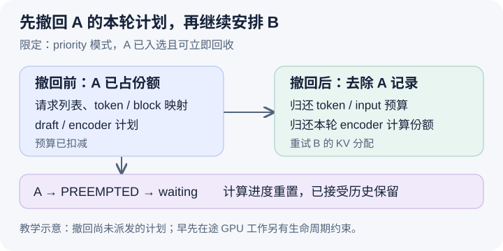

# 抢占为什么还要撤回已经写进本轮的计划

本文固定 vLLM 提交 `04c1f4a407962a37d01b573f3a2aba91dd2ed3a9`，为静态源码分析。下面 priority 与预算的数值是教学例子，机制图不是 runtime trace，没有执行 GPU、重算或性能实验。未提交的本地导读未作为证据。

昨天解释了 KV 分配失败可能触发抢占，以及抢占会重置请求进度。今天追问发生得更早的一种矛盾：调度器还在组装本轮计划，A 已经拿到份额，随后 B 申请空间失败，而根据策略恰好应抢占 A。自然方案是释放 A 的块并把它放回 waiting，但本轮计划里还留着 A 的 token 数和块描述。若直接把这份计划发给 runner，执行器就可能按一份已经失效的资源安排工作。抢占因此不能只修改请求本身，还必须维护计划各部分的一致性。

考虑 priority 模式下 running 的遍历顺序是 A、B。A 的 priority 为五，B 为零，两者都想推进一个位置；A 曾较早入场，B 后来入场，这个 running 顺序与 waiting 堆的优先级顺序不是同一结构。本轮最初两个预算都是八，A 成功后变成七，A 出现在 scheduled_running_reqs、num_scheduled_tokens 和 req_to_new_blocks 中。随后 B 分配失败，调度器在[受害者选择](https://github.com/vllm-project/vllm/blob/04c1f4a407962a37d01b573f3a2aba91dd2ed3a9/vllm/v1/core/sched/scheduler.py#L741)处选 `(priority, arrival_time)` 最大的 running 请求；本例中就是 A。它不只看当前 B，也不按已安排工作的多少挑选受害者。

释放之前先有[可立即回收检查](https://github.com/vllm-project/vllm/blob/04c1f4a407962a37d01b573f3a2aba91dd2ed3a9/vllm/v1/core/sched/scheduler.py#L750)。[_request_blocks_can_be_freed](https://github.com/vllm-project/vllm/blob/04c1f4a407962a37d01b573f3a2aba91dd2ed3a9/vllm/v1/core/sched/scheduler.py#L2603)会结合延迟释放与已处理步骤边界判断；若只能把块留待后续释放，眼前抢占也不能解决分配失败，所以循环停止。本文数值例子假设这个检查允许立即释放，A 的释放确实使 B 有足够资源；否则不能继续推演“抢占后 B 一定入选”。

在 priority 分支，源码先从 running 移除 A，并在受害者位于当前遍历位置之前时修正 req_index。若 A 已经在本轮入选，[计划撤回分支](https://github.com/vllm-project/vllm/blob/04c1f4a407962a37d01b573f3a2aba91dd2ed3a9/vllm/v1/core/sched/scheduler.py#L759)会将它从 scheduled_running_reqs 删除，弹出其 token 份额并归还 token budget，同时归还 input budget 的份额和 draft_slots。然后移除 req_to_new_blocks、对应的 speculative token 列表，以及本轮 encoder 计划，必要时归还 encoder 计算预算。这些是同一请求留下的多种计划痕迹，不能靠从一个列表删掉 A 就保持一致。

图的三个框分别表示本轮候选计划、撤回后的剩余计划和 A 的生命周期。上面的撤回箭头表示先取消尚未派发的 A 工作；下面把 A 放回候选队列表示未来可以重算。图没有表示 GPU 已执行的操作被撤销，也不意味着 KV 管理器的一切副作用都像数据库事务一样回滚。此时撤回的是 CPU 正在构造的计划，对早先在途工作仍须由独立状态字段处理。

随后 [_preempt_request](https://github.com/vllm-project/vllm/blob/04c1f4a407962a37d01b573f3a2aba91dd2ed3a9/vllm/v1/core/sched/scheduler.py#L1520)负责请求生命周期：释放相应持有关系、重置 computed 与占位、标记已有在途输出并将 A 重新入队。已接受的 token 历史没有因此被抹去，后续恢复可能需要为它们重新建立 KV。回到本例，撤回 A 让两个预算先恢复为八，B 成功安排一个位置后又变为七。B 的候选量在重试前就已计算，不能假设归还预算会自动扩大它这次的 num_new_tokens；剩余额度只能按后续控制流继续使用。

还有一个容易遗漏的边界：本轮一旦有抢占，[waiting 准入入口](https://github.com/vllm-project/vllm/blob/04c1f4a407962a37d01b573f3a2aba91dd2ed3a9/vllm/v1/core/sched/scheduler.py#L849)的条件就不再成立。因此短请求 C 即使可能放进剩余七个位置，也不会由这段 waiting 循环立刻加入同一轮。归还预算保证账目正确，并不保证每个空位都被填满。这个控制条件避免在刚刚通过抢占缓解压力的同一轮继续这段新准入；关于它的性能效果仍要实验，不能从分支推导吞吐一定增加或减少。

在 FCFS 分支，受害者取 running 尾部，而遍历按索引向前，所以没有同样的“先前已入选的低优先级请求被后来的高优先级请求撤回”清理结构。本篇的撤回例子特意限定 priority；泛化到所有策略会掩盖索引关系。[最终约束检查](https://github.com/vllm-project/vllm/blob/04c1f4a407962a37d01b573f3a2aba91dd2ed3a9/vllm/v1/core/sched/scheduler.py#L1336)验证预算和数量，之后才构建执行描述。单靠总 token 不超预算的断言仍不足以证明每个描述都指向有效块，因此请求列表与各映射的同步维护是重要的不变量。

待执行的验证应构造 A 已安排、B 分配失败且 A 为可立即回收受害者的 priority 场景，停在受害者选择、撤回后和最终输出前。观察 A 是否从所有本轮相关容器消失、两个预算是否归还相应份额、A 状态是否变成 PREEMPTED，以及 C 是否未走 waiting 准入。若最终计划仍包含已释放资源的 A，或只归还 token 而没有归还输入和 encoder 对应份额，就能推翻上述一致性解释。加入在途步骤后再检查回收门槛，不能用强行释放绕过条件。本文没有执行这些实验。
