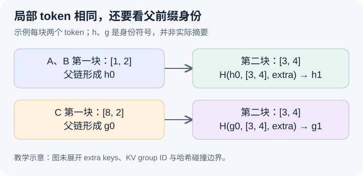

# 相同的一块 token，为什么不一定命中相同的 KV

本文基于固定提交 `04c1f4a407962a37d01b573f3a2aba91dd2ed3a9`，证据为静态源码分析。请求和哈希均是教学示意，没有执行模型、测量缓存收益或验证哈希安全性。源码工作区另有未提交的本地导读，本文未将其作为固定提交证据。

昨天追踪了抢占怎样撤回执行计划。被抢占请求稍后恢复时，若旧 KV 仍在缓存里，是否可以直接接着使用？要回答这个问题，先要知道缓存中的“相同”到底是什么。让 A 的 token 序列是 `[1,2,3,4,5]`，B 是 `[1,2,3,4,9]`，每个块覆盖两个 token。A、B 的前四个 token 相同，因此可能复用前两个块。再让 C 是 `[8,2,3,4,9]`，C 的第二块仍是 `[3,4]`，但它之前的上下文已经改变，不能只凭这两个局部 token 就认定第二块的 KV 可以复用。

自然的缓存设计是用当前块的 token 元组作 key，命中后拿回一个物理 block ID。它忽略了自回归模型中上下文对中间状态的影响。[hash_block_tokens](https://github.com/vllm-project/vllm/blob/04c1f4a407962a37d01b573f3a2aba91dd2ed3a9/vllm/v1/core/kv_cache_utils.py#L649)实际把 parent hash、当前块 token 元组和 extra keys 一起交给配置的 hash function。于是第二块的身份继承了第一块的前缀身份，而不是一个脱离上下文的词片段。这是实现对可复用前缀的编码，不是语义相似度搜索，也不是每次比较完整 K/V 张量。

图中 A、B 的第二块使用同一个父身份 h0，C 使用另一个父身份 g0。局部的 `[3,4]` 虽然一样，组合输入不同，设计上应形成不同的缓存键；图不讨论哈希碰撞。所有 h、g 都是符号，不是真实摘要。这样沿链向后递推，前部 token 的差异会进入后部块的身份，而不必把整个前缀元组重复存到每一个 key 中。

[get_request_block_hasher](https://github.com/vllm-project/vllm/blob/04c1f4a407962a37d01b573f3a2aba91dd2ed3a9/vllm/v1/core/kv_cache_utils.py#L826)从已有 hash 的末尾继续，以 hash_block_size 粒度追加新身份，并把刚计算的 hash 作为下一段的 parent。这使生成过程可以随着 token 追加而增量维护前缀身份。哈希粒度不应直接等同于所有 KV group 的物理块大小，同一版本还有粒度转换和细粒度边界探测；本篇数值例子仅讨论两者一致的完整块。

纯文本 token 还不是所有输入。[generate_block_hash_extra_keys](https://github.com/vllm-project/vllm/blob/04c1f4a407962a37d01b573f3a2aba91dd2ed3a9/vllm/v1/core/kv_cache_utils.py#L610)会组合 LoRA、多模态、cache salt 和 prompt embeddings 的相关额外信息。cache salt 在起始段进入身份，后续段再通过 parent 链继承。这里的重点是“哪些因素进入缓存身份”，不应据此泛化成所有部署之间都能直接共享缓存，或把某个字段的存在当成完整的隔离安全证明。具体输入表示与算法仍须沿各 helper 和配置继续核对。

还有另一层身份：[make_block_hash_with_group_id](https://github.com/vllm-project/vllm/blob/04c1f4a407962a37d01b573f3a2aba91dd2ed3a9/vllm/v1/core/kv_cache_utils.py#L74)把前缀 hash 与 KV group ID 组合，区分同一逻辑前缀在不同组中的物理状态。[BlockPool.get_cached_block](https://github.com/vllm-project/vllm/blob/04c1f4a407962a37d01b573f3a2aba91dd2ed3a9/vllm/v1/core/block_pool.py#L196)针对传入的各 group 查找，只要其中一个缺失就返回 None。因此“前缀 token 相同”“某组有缓存”和“这次查询完整命中”是三个不同结论。group ID 在这里表达执行时的 KV 分组，不是用户权限标识。

在普通完整块路径，[FullAttentionManager 的扫描](https://github.com/vllm-project/vllm/blob/04c1f4a407962a37d01b573f3a2aba91dd2ed3a9/vllm/v1/core/single_type_kv_cache_manager.py#L796)从前向后累积，遇到缺失就停止。这不表示后面的键在索引中必然不存在，而是这条路径不能跳过一个缺口，再把后面的块当成连续已计算前缀。该函数随后还有 fine-grained 的尾段探测，不能从本篇例子得出“当前实现永远只命中完整物理块”。对精确 token 身份做索引，换来了可核对的复用边界，也引入哈希维护、组间对齐和命中连续性的成本。

待执行的验证可以在 request block hasher 返回和 pool 查询前设置断点，用 A、B、C 的同一分块配置比较第二段 hash 的输入以及实际键，并分别改变 extra keys 和 group ID。若只改祖先 token，第二段仍仅按 `[3,4]` 查找，就能推翻本文的链式身份解释。再人为让某个所需 group 缺块，观察查询是否失败；不要把只看见一个组的 block 当成全组命中。本文没有运行这些观察。下一篇沿已找到的候选块继续：查到它，为什么还不算真正拥有它？
