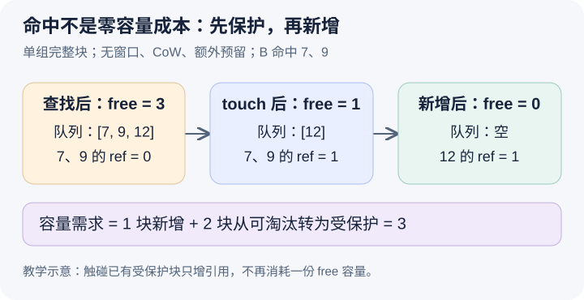

# 命中两块、只新增一块，为什么可能需要三块可用容量

本文固定源码提交 `04c1f4a407962a37d01b573f3a2aba91dd2ed3a9`，为静态源码分析。块 ID、引用计数和 free 数值是教学示意，没有运行分配实验或 GPU 工作。未提交的本地导读不属于本文证据。

沿上一篇的 A、B 继续。A 已完成，两个完整前缀块仍能由缓存键找到，物理 ID 分别为 7 和 9。B 命中这两个块，接下来一个新 token 需要第三块。自然的容量算法是“总共需要三块，命中两块，所以只要再有一块空闲”。它漏算了一种状态：7 和 9 虽有缓存内容，却已经没有请求持有，因此同时处在可分配、可淘汰的 free 队列里。B 重新采用它们时，必须先把这两块从可用容量里划走。

先把三个概念拆开。[KVCacheBlock](https://github.com/vllm-project/vllm/blob/04c1f4a407962a37d01b573f3a2aba91dd2ed3a9/vllm/v1/core/kv_cache_utils.py#L176)记录物理 block_id、ref_cnt、hash 与 free 链表指针。hash 说明能否按某个前缀身份找到内容，ref_cnt 表示受维护的持有引用，free 队列表达分配或淘汰资格。cached 与 free 不是互斥的两个盒子；一个无持有者的缓存块，正好可以同时属于两者。本文排除 null block、跨 pool 和额外内部保留，只看单一 full-attention 组的普通完整块。

前缀查找只是返回候选块，不自动获得持有权。成功采用命中块时，[add_local_computed_blocks](https://github.com/vllm-project/vllm/blob/04c1f4a407962a37d01b573f3a2aba91dd2ed3a9/vllm/v1/core/single_type_kv_cache_manager.py#L267)把 touch 与加入 req_to_blocks 配对。[BlockPool.touch](https://github.com/vllm-project/vllm/blob/04c1f4a407962a37d01b573f3a2aba91dd2ed3a9/vllm/v1/core/block_pool.py#L746)遇到 ref_cnt 为零的普通块，会先从 free 队列移除，再增加引用计数。若缓存块仍被 A 持有，则 B 只新增引用，不再重复扣一份 free 容量。同一条命中路径的容量效果，取决于块此刻是否已处于可淘汰状态。

图中 pool 最初有三个 free 块：带缓存的 7、9 和可重新分配的 12。查找阶段仍是三个；采用 7、9 后降为一个；再把 12 分给 B，降为零。计算只需要新增一个物理块，却总共占用了三个先前可分配的位置。如果最初只有 7、9 两个 free 块，B 不能既保护它们又凭空得到第三块。图没有表示 touch 重新计算了前缀，变化发生在持有关系与容量账目中。

这个补项直接出现在 [get_num_blocks_to_allocate](https://github.com/vllm-project/vllm/blob/04c1f4a407962a37d01b573f3a2aba91dd2ed3a9/vllm/v1/core/single_type_kv_cache_manager.py#L180)。在本例没有窗口跳过和部分命中的前提下，先计算真正要新增的一块，再将命中块中 ref_cnt 为零且不是 null 的数量计入返回值；[_get_num_evictable_blocks](https://github.com/vllm-project/vllm/blob/04c1f4a407962a37d01b573f3a2aba91dd2ed3a9/vllm/v1/core/single_type_kv_cache_manager.py#L165)就是相应计数。返回的三不是“再从池中取三个新块”，而是这次采用命中并新增工作需要消耗的可用容量。混淆这两个含义，就会错误地判断算法重复收费。

[KVCacheManager 的容量检查](https://github.com/vllm-project/vllm/blob/04c1f4a407962a37d01b573f3a2aba91dd2ed3a9/vllm/v1/core/kv_cache_manager.py#L566)还叠加 reserved blocks 和 watermark。本篇将它们设为零，才能把失败准确归因于候选命中块的保护成本。检查通过后，源码先采用 computed blocks，再分配新增块。这一顺序很关键：如果先从 free 队列取新块，可能把刚查到却尚未保护的 7 或 9 当成淘汰对象。本篇描述的是这条受调度器组织的调用路径，不宣称无锁地保留候选引用就对任意并发线程安全。

缓存因而节省了已有前缀的重复计算，却没有让它们在执行期间变成不占容量的状态。若 B 与仍在运行的 A 共享两块，增加 B 的引用可以复用同一份物理存储；若 A 已结束、块回到 free 队列，B 的采用则重新改变它们的可淘汰资格。两个场景都叫命中，不能仅凭命中 token 数估计新增容量，更不能由此推出 TTFT 或吞吐提升多少。

这个边界还会被模型扩展改变。滑动窗口可以跳过旧块，细粒度尾部命中可能需要私有 CoW 块，内部保留也会增加非请求引用。因此真实 ref_cnt 不应普遍翻译为“活跃请求数”，本例的简单算式也不是全部模型的通用分配公式。学习时应先标清 KV group、块粒度、窗口和共享范围，再回到 coordinator 看最终需求。

待执行的验证可以在候选查找后、容量比较前、touch 后和新块分配后分别观察 7、9 的 ref_cnt、free 队列成员及 B 的 req_to_blocks。对比最初 free 数为二与三的两种受控场景，确认前者不能完成本次分配，后者按三到一到零变化。若只有查找就使引用增加，或采用后块仍以零引用留在 free 队列，就能推翻本文的阶段划分。本文未执行这些观察。下一篇继续追踪 B 结束以后，为什么这些块再次变 free，却依然可以命中。
