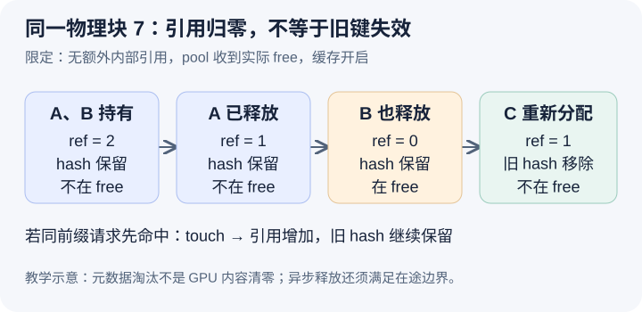

# 请求释放 KV 后，为什么缓存仍能命中，直到块被重新分配

本文基于提交 `04c1f4a407962a37d01b573f3a2aba91dd2ed3a9` 的静态源码分析。引用计数、队列和状态演化均为教学示意，没有运行缓存实验或测量淘汰效果。未提交的本地导读未作为固定提交证据。

前两篇让 B 通过前缀身份找到缓存块，并获得引用保护。现在让 A、B 同时持有完整前缀块 7，再先后结束。自然的实现是 A 结束时销毁其 KV，但这会破坏 B；另一种实现等最后一个请求结束就删除缓存索引，却让下一次相同前缀无从命中。vLLM 把请求持有关系和缓存可发现性分别维护，使最后一个请求释放之后，内容仍可能留在原处，直到容量压力要求这块空间服务新工作。

[SingleTypeKVCacheManager.free](https://github.com/vllm-project/vllm/blob/04c1f4a407962a37d01b573f3a2aba91dd2ed3a9/vllm/v1/core/single_type_kv_cache_manager.py#L578)通过 pop_blocks_for_free 移除该请求的块列表与 bookkeeping，再以反向顺序交给 pool。移除请求映射，表示这个请求不再持有这些块，并不表示其他请求的块表也被删除。[BlockPool.free_blocks](https://github.com/vllm-project/vllm/blob/04c1f4a407962a37d01b573f3a2aba91dd2ed3a9/vllm/v1/core/block_pool.py#L768)降低引用计数，只有计数降到零的普通块才进入相应的 free 队列位置。本文假设可立即释放，且没有额外内部引用，所以 A 结束时 7 从二变一，B 结束时才从一变零。

图中最关键的中间态是“ref=0、hash 保留、在 free 队列”。缓存身份仍然可以找到 7；若另一个同前缀请求先采用它，touch 会把它移出队列并增加引用。若另一个不相干请求先取得这块作为新空间，旧身份就必须失效。因此 free 是可再利用的资格，eviction 是缓存可发现性的改变，真正的数据写入又是后续执行动作。这三个时刻不能揉成一个“释放显存”的事件。

源码对 free 队列的安排也不只是全部 append。开启缓存时，无 hash 的块会被放到前部优先复用，有 hash 的块放到尾部延后淘汰；同批释放还通过反向遍历，使长链尾部的块先进入相应淘汰顺序。这样尽量先使用不能提供前缀命中的空间，再在缓存候选中选择。[FreeKVCacheBlockQueue](https://github.com/vllm-project/vllm/blob/04c1f4a407962a37d01b573f3a2aba91dd2ed3a9/vllm/v1/core/kv_cache_utils.py#L246)使用块自身的双向链表指针，使命中时能从队列中间移除块。这里核对的是数据结构和队列规则，没有实际测量它相对其他淘汰策略的性能。

当新请求 C 必须拿一个新块，[get_new_blocks](https://github.com/vllm-project/vllm/blob/04c1f4a407962a37d01b573f3a2aba91dd2ed3a9/vllm/v1/core/block_pool.py#L660)从队首取候选，在开启缓存时调用 _maybe_evict_cached_block，再把新持有引用从零增加到一。[清理旧 hash 的 helper](https://github.com/vllm-project/vllm/blob/04c1f4a407962a37d01b573f3a2aba91dd2ed3a9/vllm/v1/core/block_pool.py#L584)会移除块的主身份及相关别名，更新索引并 reset_hash，避免后续查询继续拿到已转供 C 使用的块。这个元数据步骤本身没有证明 GPU 内容已经被清零或覆盖，后续写入及可能的清零安排需要沿执行路径核对。

缓存索引也不保证一个键永远只对应一个物理块。[BlockHashToBlockMap.insert](https://github.com/vllm-project/vllm/blob/04c1f4a407962a37d01b573f3a2aba91dd2ed3a9/vllm/v1/core/block_pool.py#L83)可以把同一键下的多个物理 ID 保留下来，pop 则按键和 block ID 删除其中一个。因此淘汰 7 不一定让该前缀完全无法命中：可能还有同身份的另一物理副本。维护每个请求已有块表的稳定性，与全局即时去重是不同目标；不能看见两个键相同就直接合并引用，否则已有执行描述中的物理位置也要同步处理。

这种分离让空闲容量与缓存保留可以重叠：不急着抹掉无人持有的数据，又允许它在需要时交还给新的工作。代价是 hash 索引、物理块、引用和淘汰队列必须一致，缓存中“还在”的内容并没有获得永久驻留承诺。也不能把 ref_cnt 为零理解成立即可供任意外部代码读写，引用释放必须服从当前运行时的生命周期协议。

昨天还看到异步边界。[Scheduler._free_request_blocks](https://github.com/vllm-project/vllm/blob/04c1f4a407962a37d01b573f3a2aba91dd2ed3a9/vllm/v1/core/sched/scheduler.py#L2610)可能先拿走请求 bookkeeping，却将块放入 deferred_frees，待在途步骤满足回收条件后才交给 pool。因而图里的“最后释放”指 pool 真正收到对应 free，而不是客户端刚刚收到结束信息。本文也只画完整块，同一源码还有部分尾块缓存与特殊模型的保留规则，不能把这个图当成全实现的穷举。

待执行的验证可以先让 A、B 共享 7，分别结束它们，在 pool.free_blocks 前后检查计数、请求映射、free 成员和旧 hash 查询。两次结束之间应仍有 B 的保护；最后释放后应允许命中并重新 touch。再安排 C 取得相应候选，确认旧键与 block ID 7 的关联已移除；若旧键仍能命中，先核对返回的是不是其他副本。若 C 已接管 7，旧键仍返回同一个 7，就能推翻本文的淘汰一致性解释。本文没有执行上述实验。
