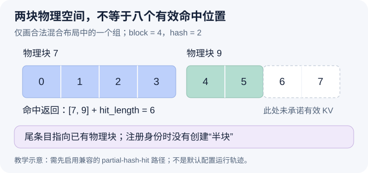

# 前缀只命中六个 token，为什么可以返回两个四槽物理块

本文固定源码提交 `04c1f4a407962a37d01b573f3a2aba91dd2ed3a9`，属于静态源码分析。数值和机制图为教学示意，没有启动混合模型、记录真实命中或测量收益。源码工作区另有未提交的本地导读，本文未将其作为提交证据。

10 月 15 日区分了缓存身份、持有引用与淘汰资格，例子都停在完整块边界。今天让生产者 A 的 prompt 长度为六，观察其中一个 full-attention KV group：物理块覆盖四个 token，hash 粒度为二。A 的前四个位置在块 7，位置四和五在块 9 的前半部。消费者 B 也有相同的前六个 token，但还要继续处理不同的后缀。若命中只允许停在四的倍数，B 必须重算后面两个位置；若按更细边界复用，就要表达“两个物理块已找到，但只复用六个位置”。

首先必须限定这个例子何时成立。[HybridKVCacheCoordinator 的开关](https://github.com/vllm-project/vllm/blob/04c1f4a407962a37d01b573f3a2aba91dd2ed3a9/vllm/v1/core/kv_cache_coordinator.py#L693)不只检查 hash 粒度，还要求允许 partial hits、存在满足条件的 Mamba align 组，并检查其他 manager 的兼容性。[命中对齐属性](https://github.com/vllm-project/vllm/blob/04c1f4a407962a37d01b573f3a2aba91dd2ed3a9/vllm/v1/core/kv_cache_coordinator.py#L719)才会在启用后改用 hash_block_size。本篇只画这个合法混合布局中的一个 full-attention 组，并假设其他组也支持六这个共同命中边界；没有构造并运行实际模型配置，不能把它当成普通单组模型的默认行为。

自然方案是把缓存的最小单位直接缩成两个 token 的物理块。那会同时改变分配和执行的数据布局。这里采用另一种分离：物理块仍有四个槽，缓存身份却可以标识其中某个前缀边界。[FullAttentionManager._cache_partial_tail_block](https://github.com/vllm-project/vllm/blob/04c1f4a407962a37d01b573f3a2aba91dd2ed3a9/vllm/v1/core/single_type_kv_cache_manager.py#L861)把 prompt 长度向下取到 hash 粒度边界，确认这条边界已经被当前 num_tokens 覆盖且落在物理块内部，再为对应尾块注册条目。它只登记 prompt 的最后一个 hash 边界，不为块内每一个中间位置都自动建立条目。

图里块 9 的前半部覆盖逻辑位置四、五，后半部虽然有空间，却不属于六 token 命中所承诺的有效前缀。缓存条目指向现有块，而不是新造一个“半块”。[BlockPool.cache_partial_block](https://github.com/vllm-project/vllm/blob/04c1f4a407962a37d01b573f3a2aba91dd2ed3a9/vllm/v1/core/block_pool.py#L447)维护这类元数据，必要时通过主 hash 或别名记录键到物理块的关系。登记身份不会在这里分配新块或执行 GPU 复制，不能从索引中出现一个键推断数据搬运已经完成。

查找也分成两段。[完整块扫描](https://github.com/vllm-project/vllm/blob/04c1f4a407962a37d01b573f3a2aba91dd2ed3a9/vllm/v1/core/single_type_kv_cache_manager.py#L796)先取得连续完整块；进入 fine-grained 模式后，[尾段探测](https://github.com/vllm-project/vllm/blob/04c1f4a407962a37d01b573f3a2aba91dd2ed3a9/vllm/v1/core/single_type_kv_cache_manager.py#L816)才在第一个非完整区段中从较长边界向较短边界检查，找到可用条目后停止。对 B，块 7 先给出四个位置，尾条目再给出两个。若中间条目根本未注册，查找不会凭空把生产者块中的任意内容当成可复用状态。

[返回前的对齐与裁剪](https://github.com/vllm-project/vllm/blob/04c1f4a407962a37d01b573f3a2aba91dd2ed3a9/vllm/v1/core/single_type_kv_cache_manager.py#L836)保留 hit_length，再按向上取整确定覆盖它所需的物理块数。本例结果可以是 `[7,9]` 与六，而不是块列表长度二乘块大小四所得的八。后续调度必须使用六作为逻辑复用进度，并保留尾块是部分命中的事实。若只从块表长度反推计算进度，就会跳过本应处理的位置六、七。

这种分离以更多缓存键、探测和后续私有化工作，换取不受物理页边界完全限制的复用机会。它还受共同组边界、模型状态语义及特定解码规则约束，不代表任意 token 长度都可命中。究竟省下的重算是否抵消索引与复制成本，需要实际运行后分别测量，本文没有相应性能证据。

待执行的调试应先确认 coordinator 的 enable_partial_hash_hits 与 cache_hit_alignment_tokens，再在尾条目登记、fine-grained 探测和函数返回处观察 boundary_tokens、块 ID 和 hit_length。让 A 的有效尾条目停在六、B 的 prompt 超过六，并确保其他组支持同一边界；预期尾组返回两个四槽块但只报告六个位置。若返回进度被直接算成八，就能推翻本文的有效跨度解释。关闭相应 gate 后再比较是否仍走内部边界探测。本文未执行这些观察，下一篇讨论 B 为什么不能直接在共享块 9 的空位继续写。
