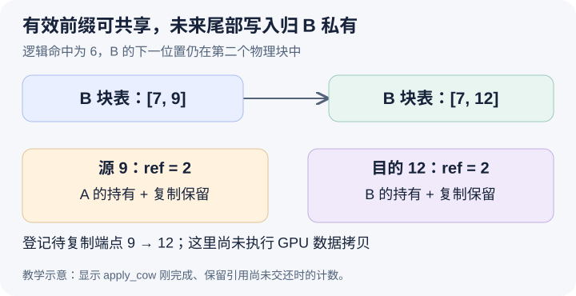

# 命中的尾块还有空位，为什么仍要分配私有副本

本文固定提交 `04c1f4a407962a37d01b573f3a2aba91dd2ed3a9`，证据为静态源码分析。引用计数与块表是教学示意，没有执行 CoW 或检验 GPU 数值。未提交的本地导读未作为固定提交证据。

沿上一篇的边界继续：B 复用六个 token，尾块 9 有四个槽，其中前两个覆盖有效前缀。A 仍持有这个生产者块，B 接下来要把自己的后缀写到逻辑位置六。自然方案是保留 B 的尾块 ID 为 9，直接在槽二、三追加；但 A 也可能继续生成不同的后缀。二者共享的只是已匹配的前缀，并没有约定未来生成相同。即使当前看起来有空槽，也不能把这些槽的写入归属同时交给两个独立请求。

因此问题不只是 ref_cnt 是否大于一，而是这次命中是否停在一个需要继续写入的物理块内部。[_has_partial_local_hit](https://github.com/vllm-project/vllm/blob/04c1f4a407962a37d01b573f3a2aba91dd2ed3a9/vllm/v1/core/single_type_kv_cache_manager.py#L168)用命中块非空以及 num_local_computed_tokens 对 block_size 的余数判断这种情况。本例六对四取余为二，必须进入对应私有化路径。本文延续合法混合布局中 full-attention 组的观察，不将这段基类行为当成所有特殊 manager 的完整实现。

采用命中块后，[partial-hit bookkeeping](https://github.com/vllm-project/vllm/blob/04c1f4a407962a37d01b573f3a2aba91dd2ed3a9/vllm/v1/core/single_type_kv_cache_manager.py#L318)记录尾块索引和源块，将该请求已缓存的完整块数量限制在尾部之前。这样 B 的尾部私有副本以后变完整时仍能按 B 的序列建立身份，而不会因为“命中时已有两个块”就误以为第二块也是 B 的完整缓存块。逻辑命中进度、块表长度和已登记完整块数在这里各有含义。

[allocate_new_blocks 的 partial 分支](https://github.com/vllm-project/vllm/blob/04c1f4a407962a37d01b573f3a2aba91dd2ed3a9/vllm/v1/core/single_type_kv_cache_manager.py#L385)先取得私有块 12，再调用 _apply_cow。本例 B 的块表从 `[7,9]` 变成 `[7,12]`，完整共享前缀块 7 保持不变，尾部逻辑块的位置也不变，只替换物理目的地。之后再按所需 token 范围判断是否需要更多块。即使 B 下一步仍没有跨过这块的物理边界，私有尾块也可能不可省略，因为它解决的是写入归属，既有块数的 ceil 公式表达不了这个约束。

图的上半部表示块表变化，下半部表示 _apply_cow 刚结束、复制保留引用尚未交还时的状态。假设 A 是源块 9 原有的唯一请求持有者，B 采用后源块计数为二。[_apply_cow](https://github.com/vllm-project/vllm/blob/04c1f4a407962a37d01b573f3a2aba91dd2ed3a9/vllm/v1/core/single_type_kv_cache_manager.py#L451)替换 B 的映射后，没有立即归还 B 原先取得的源块引用，而把它用作复制期间的保留；新分配的 12 则从一再增加到二，分别支撑请求与复制。于是源块计数二不再等于两个请求都指向它，而是 A 加复制保留。

这一点堵住了另一种反例：CPU 已经决定复制 9 到 12，但 B 在本轮内被取消或撤回，若只按照块表释放请求引用，就可能让目的块在 GPU 复制使用它之前被重新分配。复制端点的额外持有关系使这类内部工作不完全依赖请求仍然活着。它还解释了为什么不能普遍把 ref_cnt 当作活跃请求数量；具体何时能归还这些保留引用，仍需要下一篇的执行与回收协议。

容量估计也提前考虑 CoW。[额外预留分支](https://github.com/vllm-project/vllm/blob/04c1f4a407962a37d01b573f3a2aba91dd2ed3a9/vllm/v1/core/single_type_kv_cache_manager.py#L261)在 partial hit 时增加一个新块需求，再与前一组文章讲过的可淘汰命中块成本合并。这个一是私有尾块的真实容量成本，不是因为 B 多生成了一个 token。若命中节省了两个位置的重算，却要增加一整块物理存储和后续复制，性能与容量取舍都应分别记录，不能只报命中长度。

最后要区分“改映射”和“复制数据”。[_apply_cow 记录待复制端点](https://github.com/vllm-project/vllm/blob/04c1f4a407962a37d01b573f3a2aba91dd2ed3a9/vllm/v1/core/single_type_kv_cache_manager.py#L469)，但这里没有执行 GPU 张量拷贝。B 的 CPU 块表已经指向 12，不代表 12 的有效前缀已经就绪。新块的注册、输入准备与复制必须按照执行协议连起来，否则单看最终块表会漏掉数据依赖。

待执行的验证可停在 partial 检测、CoW 分配与 _apply_cow 返回后，检查 B 的尾块 ID 是否变化、源和目的计数、_pending_cow_copies 以及 num_cached_block。让 B 本轮只追加一个位置，验证即使没有跨页也仍需私有尾块；再在复制保留释放前取消 B，检查端点是否仍被相应引用支撑。若块表改到 12 却没有复制描述，或原始源块引用立即丢失且无替代保留，就能推翻本篇解释。本文没有执行这些实验。
