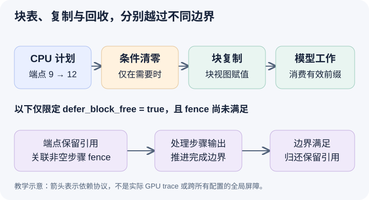

# CPU 已经换好块表，旧 KV 怎样到达 GPU 的私有尾块

本文基于固定提交 `04c1f4a407962a37d01b573f3a2aba91dd2ed3a9` 的静态源码分析。描述符、步骤号和图都是教学示意，没有采集 GPU trace、验证复制数值或测量带宽。未提交的本地导读不属于本文源码证据。

前两篇让 B 在逻辑长度六处命中，并把尾块从源 9 重定向到私有目的 12。现在产生一个短暂但重要的分离：CPU 已认定下一轮使用 12，GPU 却还需要取得 9 中的有效前缀。自然方案是分配新块后立即在调度器里复制，但调度器管理的是块元数据与请求进度，GPU 存储与执行布局由 worker 持有。把“要复制什么”作为本轮协议传过去，才能让数据准备与模型执行在同一条运行路径中排序。

[KVCacheManager.take_kv_cache_block_copies](https://github.com/vllm-project/vllm/blob/04c1f4a407962a37d01b573f3a2aba91dd2ed3a9/vllm/v1/core/kv_cache_manager.py#L888)收集各 manager 的待复制端点，形成 src_block_id 和 dst_block_id 描述，同时返回端点保留引用供回收处理。这些描述不携带 B 的六 token 命中长度，不能把它理解成“只复制两个有效 token”的指令。[Scheduler 的收集点](https://github.com/vllm-project/vllm/blob/04c1f4a407962a37d01b573f3a2aba91dd2ed3a9/vllm/v1/core/sched/scheduler.py#L1416)将复制计划装进 SchedulerOutput，模型执行侧才能与新块、请求及其他元数据一起接收。

图的上半部表示描述随计划传到 worker，再执行必要的新块清零、块复制和模型工作。顺序中的清零是有条件的：只有本轮提供相应新块 ID 时才发生。若把清零放在复制之后，就可能抹掉刚搬来的有效前缀。图的下半部单独限定 defer_block_free 为真，表示复制端点的保留引用如何跨过在途步骤；它不是所有配置都会走的全局同步屏障。

在本篇主要追踪的 [GPUModelRunner._update_states 路径](https://github.com/vllm-project/vllm/blob/04c1f4a407962a37d01b573f3a2aba91dd2ed3a9/vllm/v1/worker/gpu_model_runner.py#L1223)，条件清零之后才调用 copy_kv_cache_blocks_inplace，随后继续更新运行批次。另一套 runner 也在其[数据准备位置](https://github.com/vllm-project/vllm/blob/04c1f4a407962a37d01b573f3a2aba91dd2ed3a9/vllm/v1/worker/gpu/model_runner.py#L1192)明确安排先清零、再复制、再让 forward 使用。这些源码位置提供的是调用与依赖顺序，并不等于已经观测到某个设备、stream 或后端的实际执行时间。

[copy_kv_cache_blocks_inplace](https://github.com/vllm-project/vllm/blob/04c1f4a407962a37d01b573f3a2aba91dd2ed3a9/vllm/v1/worker/utils.py#L685)把端点索引放到设备，遍历 KV cache 张量，按 num_blocks、shape 与 stride 构造以调度块为单位的视图，再执行目的块赋值。它会避免对相同 view 或满足条件的共享底层存储重复复制，也处理一个调度块对应多个 kernel block 的情形。因此不能从元数据块 ID 直接猜出张量第一维或实际复制字节数。当前 helper 的操作粒度是块视图，逻辑上只命中一段前缀，也不意味着数据搬运只覆盖那段前缀。

块的后缀即使被一并搬运，也不因复制就成为 B 的已计算 token。有效跨度仍由前面保留的 hit_length 和后续输入位置决定；B 必须计算并写入自己的后缀。把“目的块已有字节”当成“这些位置都已属于 B 的有效 KV”，会重新制造第一篇所警告的六被误算成八的问题。对其他 KV group 的状态含义与特殊拷贝处理，还需分别核对，不能用 full-attention 的槽位直觉替代模型状态协议。

保留引用的回收还要看配置。[_free_cow_retained_blocks](https://github.com/vllm-project/vllm/blob/04c1f4a407962a37d01b573f3a2aba91dd2ed3a9/vllm/v1/core/sched/scheduler.py#L2621)在未启用延迟释放时直接归还引用；只有需要延迟且步骤边界未满足时才加入 deferred_frees。本篇不把这个直接分支解释成一个独立的 GPU 完成事件，也不从函数注释推断所有路径必定等到复制结束才减少计数。跨线程、stream 与 connector 的安全性必须沿具体配置核对。

限定 defer_block_free 为真时，可以沿步骤边界给出更精确的解释。复制计划把保留引用关联到下一个非空步骤的 fence；[update_from_output 的推进](https://github.com/vllm-project/vllm/blob/04c1f4a407962a37d01b573f3a2aba91dd2ed3a9/vllm/v1/core/sched/scheduler.py#L1917)在处理对应非空输出时增加 processed_step_seq，并排空已满足边界的延迟释放。这样保护的是在途工作仍可能访问的物理端点，而不是请求是否还在 running。该策略也有暂时保留容量的代价，不能把延迟回收当成没有成本的安全开关。

待执行的验证应记录 SchedulerOutput 中 9 到 12 的复制描述，在 worker 的条件清零与复制调用处停下，检查块视图和 B 的逻辑进度，然后用设备 trace 验证复制与依赖工作顺序。另在满足延迟释放条件的配置中记录 fence、processed_step_seq 和端点计数，观察步骤完成前是否仍保留引用。若没有复制描述而 B 直接依赖新块的旧前缀，或边界未满足就重新分配受保护端点，就能推翻本篇协议解释。本文没有执行这些观察，也没有报告性能收益。
