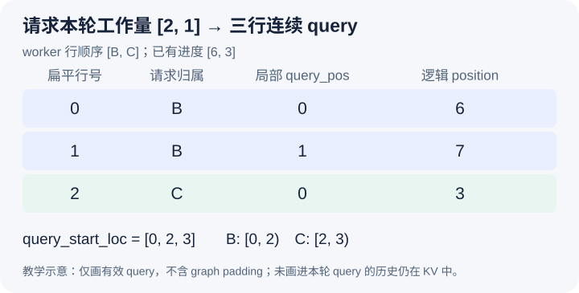

# 两个进度不同的请求，怎样变成同一轮连续输入

本文固定 vLLM 提交 `04c1f4a407962a37d01b573f3a2aba91dd2ed3a9`，证据为静态源码分析。数组、位置和机制图都是教学示意，没有启动模型或测量输入准备开销。源码工作区另有未提交的本地导读，本文没有将其作为固定提交证据。

10 月 17 日把消费者 B 的部分命中尾块改成了私有块 12。今天假设对应有效前缀已由执行协议准备好，继续看它怎样进入本轮模型输入。B 的 prompt 有八个 token，已复用前六个，本轮安排位置六、七；另一个请求 C 正在 decode，已知序列有四个 token，计算进度为三，本轮处理位置三。两个请求的已知长度和本轮工作量都不同，模型却需要一组可连续读取的输入张量。

自然方案是把每个请求补到相同长度，放成二维数组，或者把完整历史每轮重新发送。前者会引入额外填充，后者把 KV 已保存的历史再当成本轮 query。当前路径先取每个请求真正被安排的区段，再按运行批次行顺序拼接。本文主要追踪 `GPUModelRunner._prepare_inputs`，限定普通文本、同步、无推测解码且不画 CUDA Graph padding；不把这里的三行示意当成所有 runner 与配置的实际张量形状。

顺序首先来自 worker 的 persistent batch。[构造本轮计数数组](https://github.com/vllm-project/vllm/blob/04c1f4a407962a37d01b573f3a2aba91dd2ed3a9/vllm/v1/worker/gpu_model_runner.py#L4227)按 input_batch.req_ids 读取调度字典，而不是直接假设字典值的排列就是张量行序。设当前 worker 行顺序是 `[B,C]`，计数数组就是 `[2,1]`。请求的 token 缓冲、计算进度和块表也必须与这些行保持对应；调度器知道每个 ID 的份额，还不足以替代执行侧的行映射。

图中第一、二行来自 B 的位置六、七，第三行来自 C 的位置三。扁平行号是零、一、二，序列逻辑位置却是六、七、三；二者都不是物理 KV 槽。B 前六个位置没有重新出现在本轮 query 中，后续 attention 仍然要读取它们的 KV。展平省去的是本轮输入中重复携带历史的需求，不意味着历史 attention 工作也消失了。

[req_indices 的生成](https://github.com/vllm-project/vllm/blob/04c1f4a407962a37d01b573f3a2aba91dd2ed3a9/vllm/v1/worker/gpu_model_runner.py#L1977)把请求行号按安排数重复，本例得到 `[0,0,1]`。局部 query_pos 是 `[0,1,0]`，表示每个请求在本轮区段内的偏移。[positions_np 的计算](https://github.com/vllm-project/vllm/blob/04c1f4a407962a37d01b573f3a2aba91dd2ed3a9/vllm/v1/worker/gpu_model_runner.py#L1986)再将各请求已有进度加到这个偏移上，于是得到 `[6,7,3]`。相同的局部偏移零，可以对应两个完全不同的上下文位置，不能拿 query_pos 直接作为序列位置编码。

取 token ID 时还要跨过二维 CPU 缓冲的行跨度。[token_indices 的计算](https://github.com/vllm-project/vllm/blob/04c1f4a407962a37d01b573f3a2aba91dd2ed3a9/vllm/v1/worker/gpu_model_runner.py#L2000)将逻辑位置加上请求行号乘缓冲行宽，再从展平存储中收集本轮输入。本例若行宽为 M，索引是 `[6,7,M+3]`，而不是 `[6,7,3]`。前一个三属于 C 的行内位置，忽略 M 就会错误地从 B 的存储行取 token，即使最后张量长度仍然是三，也可能已经混入另一个请求的数据。

展平后还需要保留区段边界。[query_start_loc 的构造](https://github.com/vllm-project/vllm/blob/04c1f4a407962a37d01b573f3a2aba91dd2ed3a9/vllm/v1/worker/gpu_model_runner.py#L2062)以前缀和生成 `[0,2,3]`，使 B 对应半开区间 `[0,2)`，C 对应 `[2,3)`。它表达 query 张量中的请求分段，不是序列总长度，也不是 KV 缓存地址。整个数组的最后一个有效值等于本例实际安排的 token 总数，而相邻差值恢复每个请求本轮的 query 数。

真实路径还在设备侧构造最终位置。[GPU positions 的赋值](https://github.com/vllm-project/vllm/blob/04c1f4a407962a37d01b573f3a2aba91dd2ed3a9/vllm/v1/worker/gpu_model_runner.py#L2177)使用设备上的 num_computed_tokens；在更复杂的异步或推测配置中，接受数和上一轮映射还会参与状态修正，不能把 CPU 上的初步 positions_np 普遍当成最终运行事实。本文的同步例子使这两者一致，只是为了先看清请求行、局部偏移和逻辑位置的三个坐标。

这套表示把不同长度的工作压成连续 query，同时将边界和历史状态放到元数据中。代价是这些数组必须共同遵守同一行序，单独检查 shape 无法发现所有错配。待执行的验证可在计数数组、token gather 和 _prepare_inputs 返回处观察 req_ids、req_indices、query_pos、positions 与 query_start_loc，再交换 B、C 的 worker 行序，检查所有相关表示是否随之同步变化。若行序改变而 token、位置或边界仍按旧顺序拼接，就能推翻本文的一致性解释。本文未运行这些断点。
