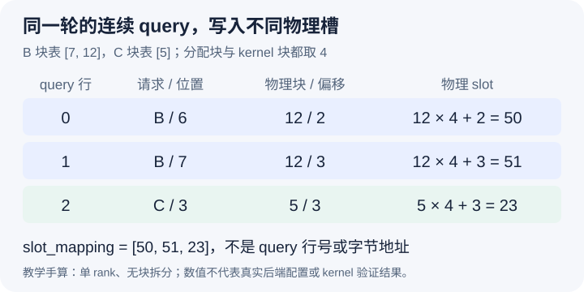

# 展平输入的第三行，为什么要写进 KV 槽 23

本文固定源码提交 `04c1f4a407962a37d01b573f3a2aba91dd2ed3a9`，属于静态源码分析。块 ID 与数组均为教学示意，没有执行映射 kernel 或检查 GPU 写入。未提交的本地导读不属于提交证据。块大小四仅用于手算，不代表任何指定 attention 后端实际接受这套配置。

接着上一篇，query 张量有三行，逻辑位置是 `[6,7,3]`，请求区段是 B 的前两行和 C 的最后一行。假设观察的 full-attention 组中 B 的块表是 `[7,12]`，C 的块表是 `[5]`，分配块与 kernel 块的大小暂且都为四，并且不启用上下文并行。若把 query 行号直接当成 KV 写入槽，就会依次写零、一、二，彻底绕开分页和请求持有关系。模型输入连续，不代表各个输入对应的持久存储也连续。

[BlockTable.compute_slot_mapping](https://github.com/vllm-project/vllm/blob/04c1f4a407962a37d01b573f3a2aba91dd2ed3a9/vllm/v1/worker/block_table.py#L201)接收请求区段、逻辑位置和设备块表，生成本轮 token 到缓存槽的映射。映射 kernel 先根据 query_start_loc 选出某个请求的输入区段，再使用这个请求对应的块表行。B 与 C 可以出现同样的逻辑位置，但必须查各自的块映射，不能只按位置在全局找一个块。

图中 B 的位置六落在逻辑块一、块内偏移二，查 B 的第二个块得到物理 ID 12，故槽为 `12×4+2=50`。位置七得到 51。C 的位置三落在自己的逻辑块零，查表得到物理 ID 5，故槽为 `5×4+3=23`。最终 slot_mapping 是 `[50,51,23]`。这里的第三行只是本轮连续张量里的行二，23 则是这个 KV 组中的物理 token 槽，它们没有数值相同的义务。

这套简化算式可以在[实际块号读取](https://github.com/vllm-project/vllm/blob/04c1f4a407962a37d01b573f3a2aba91dd2ed3a9/vllm/v1/worker/block_table.py#L470)和[槽号组合](https://github.com/vllm-project/vllm/blob/04c1f4a407962a37d01b573f3a2aba91dd2ed3a9/vllm/v1/worker/block_table.py#L475)处核对。源码还包括上下文并行的虚拟块、rank 归属和局部偏移转换；只有在本例的单 rank、同粒度条件下，才退化为熟悉的查表后乘块大小加余数。不能把这条手算公式直接覆盖 DCP 或 PCP 的分片布局。

slot 也不是可以直接相加的设备字节地址。每个 token 还有 head、head size、K/V 布局与 dtype；实际存储操作再把槽与张量 stride 等信息组合。以本轮数据量为三去检查 slot 是否小于三，同样是混淆了 query 空间与物理容量。应检查它是否落在该 cache 的有效地址范围，并且确实属于这个请求可写的映射。

分配块与 kernel 块还可能不等大。[BlockTable 的构造分支](https://github.com/vllm-project/vllm/blob/04c1f4a407962a37d01b573f3a2aba91dd2ed3a9/vllm/v1/worker/block_table.py#L91)在二者不同时要求整除关系，并使用较小的 kernel block 解释执行侧块表。[map_to_kernel_blocks](https://github.com/vllm-project/vllm/blob/04c1f4a407962a37d01b573f3a2aba91dd2ed3a9/vllm/v1/worker/block_table.py#L262)把一个分配 ID 展开成一组 kernel ID。若调试时直接用分配器给出的 ID 去比对转换后的设备表，就可能把合法展开误判为地址错误。这里必须先说清正在观察哪种粒度。

不同 KV 组也不一定使用同一种 token slot 语义。映射入口对 [SlotMappingMode.NONE 的处理](https://github.com/vllm-project/vllm/blob/04c1f4a407962a37d01b573f3a2aba91dd2ed3a9/vllm/v1/worker/block_table.py#L208)会直接返回，Mamba 类状态缓存不能简单套上本篇的逐 token 槽图。昨天的混合布局中，本文只展开 full-attention 组，不声称其他组拥有相同的 `[50,51,23]`。

最后，这个数组通过后端接口进入真实 KV 更新。[Triton attention 的 do_kv_cache_update](https://github.com/vllm-project/vllm/blob/04c1f4a407962a37d01b573f3a2aba91dd2ed3a9/vllm/v1/attention/backends/triton_attn.py#L764)在普通缓存路径把 key、value、缓存张量和 slot_mapping 传给 reshape-and-cache 操作。生成映射本身没有完成这些写入，也没有替代昨天的 CoW 数据准备。只有后续执行遵守同一块表与依赖关系，私有尾块才真正承接 B 的后缀。

待执行的验证可在映射调用前后保存同一轮的请求区段、设备 positions、执行侧块表与 slot_mapping，并在真实后端支持的块大小下按同样方法手算。改变 C 的物理块 ID 而保持逻辑位置不变，预期只改变 C 对应的槽；改变 B 的尾块为私有副本，预期 B 的新写入指向新块。若逻辑位置正确而写入仍落到旧共享尾块，就能推翻映射与 CoW 衔接的解释。本文没有运行这些观察，也没有以手算结果冒充 kernel 正确性测试。
