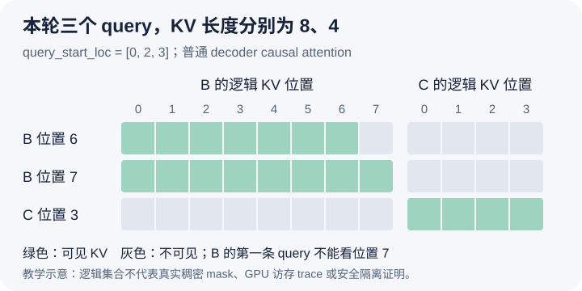

# 本轮只有三个 query，attention 为什么还要知道八个和四个 KV

本文基于提交 `04c1f4a407962a37d01b573f3a2aba91dd2ed3a9` 的静态源码分析。矩阵与数值为教学示意，没有执行 attention、检查输出精度或测量性能。未提交的本地导读不作为固定提交证据；四槽块只是比例尺，实际实验必须使用后端支持的配置。

前两篇得到三个展平 query，以及本轮 KV 的写入位置 `[50,51,23]`。但这张写入清单还不能告诉 attention 应读哪些历史。B 本轮有两个 query，已有六个前缀位置，所以本轮纳入计算后的上下文长度是八；C 本轮只有一个 query，已有三个历史位置，上下文长度是四。如果把 query 数 `[2,1]` 当成 KV 长度，B 的已缓存前缀就会被截掉。反过来，把每个请求的上下文都取批次最大值八，又会扩大 C 的合法读取范围。

[设备 seq_lens 的构造](https://github.com/vllm-project/vllm/blob/04c1f4a407962a37d01b573f3a2aba91dd2ed3a9/vllm/v1/worker/gpu_model_runner.py#L2181)将每请求计算进度与本轮安排量相加。在本例同步、无推测解码的条件下，得到 `[8,4]`，同时 query_start_loc 是 `[0,2,3]`。前者描述每个请求这轮的 KV 有效范围，后者描述 query 张量里的分段。它们虽有相同的请求行序，却不是可以互换的长度数组。更复杂配置中的进度仍可能是乐观值，本文不据字段名推断所有 GPU 工作已经完成。

[CommonAttentionMetadata 的组装](https://github.com/vllm-project/vllm/blob/04c1f4a407962a37d01b573f3a2aba91dd2ed3a9/vllm/v1/worker/gpu_model_runner.py#L2428)把 query 边界、seq_lens、块表、slot_mapping、最大长度和 causal 属性一起交给执行路径。slot_mapping 解决本轮新 K/V 写到哪里，块表则让读取方沿某个请求的逻辑历史找到全部物理页。只保留前者会丢失旧前缀的位置；只有块表却没有有效长度，又无法分清已分配容量与本轮合法上下文。

图把 B 与 C 的 KV 列分成两组，绿色表示允许读取，灰色表示不属于该 query 的可见集合。B 在位置六的第一条 query 可见自己位置零到六，不能看位置七；位置七的第二条 query 才可见零到七。C 在位置三的 query 只看 C 自己零到三的 KV，不因展平时排在 B 后面就接着读取 B 的历史。该图用于解释逻辑掩码，不表示运行时真的物化了这样一张稠密矩阵。

这种关系可以沿 Triton backend 继续核对。[unified_attention 的调用](https://github.com/vllm-project/vllm/blob/04c1f4a407962a37d01b573f3a2aba91dd2ed3a9/vllm/v1/attention/backends/triton_attn.py#L663)接收 query 分段、每请求 KV 长度、块表以及 causal 配置。kernel 恢复当前请求后，[context_len 的计算](https://github.com/vllm-project/vllm/blob/04c1f4a407962a37d01b573f3a2aba91dd2ed3a9/vllm/v1/attention/ops/triton_unified_attention.py#L389)是 seq_len 减去这条请求本轮的 query 长度。本例 B 为六，C 为三，因此本轮局部 query 偏移能重新映射到各自的绝对上下文位置。

[query_abs_pos 的构造](https://github.com/vllm-project/vllm/blob/04c1f4a407962a37d01b573f3a2aba91dd2ed3a9/vllm/v1/attention/ops/triton_unified_attention.py#L519)用 context_len 加局部 query_pos。普通 causal 分支中的[基础掩码](https://github.com/vllm-project/vllm/blob/04c1f4a407962a37d01b573f3a2aba91dd2ed3a9/vllm/v1/attention/ops/triton_attention_helpers.py#L355)要求 key 的逻辑位置不超过这个值。于是即便 B 的位置六、七在同一轮计算和写入，第一条 query 也不会因为槽 51 已有内容就合法读取未来位置七。数据存在与计算可见性是两个边界，前几篇区分有效跨度的原则在这里继续成立。

物理读取又经过另一层映射：[KV tile 的块表读取](https://github.com/vllm-project/vllm/blob/04c1f4a407962a37d01b573f3a2aba91dd2ed3a9/vllm/v1/attention/ops/triton_unified_attention.py#L429)按当前请求的表行和 key 逻辑位置取得物理块。B 的前缀可能跨块 7 和 12，C 使用块 5；物理块在池中是否相邻，并不决定它们能否互相 attend。图里的请求隔离来自分段、表行与长度共同约束，而不是给全池中的槽号做一个全局三角形比较。

这也给出一个调试反例：如果给 C 错配了 B 的块表行，query_start_loc 和 seq_lens 仍可能拥有完全正确的 shape，输出却会读取错误历史。反之，块表正确但 seq_lens 或 causal 条件错了，也可能读到无效或未来内容。排查时必须把请求 ID、worker 行号、query 区段、逻辑长度和组内块表一起保存，而不是只打印某个指针或批次 token 总数。

这些数组把不同请求的工作组织成一次可执行表示，代价是元数据一致性与多种掩码规则的维护。本文只讨论普通 decoder causal full attention，未展开 sliding window、多模态双向区段、cascade、上下文并行或 CUDA Graph padding。待执行的验证可固定 B、C 的请求顺序，对照 `[0,2,3]`、`[8,4]`、块表和逐 query 可见范围，在本轮 KV 更新后、attention 读取前，用有限数值只扰动 B 未来位置七的 KV，检查 B 的位置六输出是否不受影响；只扰动 C 的历史，检查 B 是否保持不变。这样避免扰动被随后的 KV 更新覆盖，也不以 NaN 干扰掩码判断。任何比较都需真实运行并控制数值误差，本文尚未执行。
