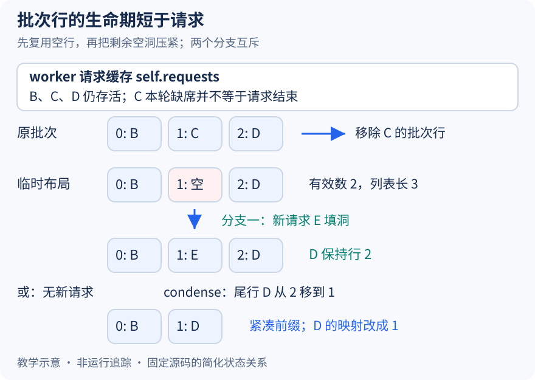

# 请求还没结束，为什么先从 persistent batch 消失

本文固定 vLLM 提交 `04c1f4a407962a37d01b573f3a2aba91dd2ed3a9`，证据为静态源码分析。请求与行号均为教学示意，没有运行模型、记录 GPU 轨迹或测量整理开销。源码工作区另有未提交的本地导读，未作为本文证据。

昨天追到了按请求行展平 query 的过程，今天往前追问：这些行怎样在每轮形成？设 worker 原有三行 `[B,C,D]`，下一轮只安排 B 与 D。C 可能被抢占，也可能只是本轮没有计算份额。如果每轮重建所有请求的 token、块表和采样缓冲，就容易保持紧凑，却失去跨轮复用大部分状态的机会。persistent batch 保留已有行，只增量处理出入，因而必须解决留下空洞后的地址变化。

首先要把请求存活和本轮入批分开。[移除未安排请求的路径](https://github.com/vllm-project/vllm/blob/04c1f4a407962a37d01b573f3a2aba91dd2ed3a9/vllm/v1/worker/gpu_model_runner.py#L1249)从已有批次中排除本轮不应保留的请求，但保留 worker 的请求缓存，供将来恢复。这里还处理 resumed 请求先清旧行再加入的边界，不能简单认为 unscheduled 集合永远就是已有集合减调度集合。真正完成的请求另经[finished_req_ids 清理](https://github.com/vllm-project/vllm/blob/04c1f4a407962a37d01b573f3a2aba91dd2ed3a9/vllm/v1/worker/gpu_model_runner.py#L1205)，从 self.requests 弹出缓存对象。因此看到 remove_request(C)，只能判断 C 离开这份批次，不能据此断言整个请求已结束。

[InputBatch.remove_request](https://github.com/vllm-project/vllm/blob/04c1f4a407962a37d01b573f3a2aba91dd2ed3a9/vllm/v1/worker/gpu_input_batch.py#L525)删除 ID 到行的映射、登记空行、把对应 ID 置空并清理相关批次状态。此刻例子变成 `[B,空,D]`，D 仍在行二。[num_reqs](https://github.com/vllm-project/vllm/blob/04c1f4a407962a37d01b573f3a2aba91dd2ed3a9/vllm/v1/worker/gpu_input_batch.py#L1108)取映射大小，所以有效请求数已经是二，但底层 ID 列表暂时有三项。若现在仅遍历前两行，D 就会漏掉；“有效数为二”并不意味着中间状态已经整理完成。

图中保留的请求缓存和批次行是两个容器。C 的缓存可以仍然存在，而批次已经没有 C。图的上方分支表示如果 E 入场，就先占用行一，保持 D 不动；下方分支才是本文继续使用的无新请求情形，D 从二移到一。两个分支是互斥的教学选择，没有表示一轮先后发生两次入场。

先填洞再压紧很关键。[注册加入操作](https://github.com/vllm-project/vllm/blob/04c1f4a407962a37d01b573f3a2aba91dd2ed3a9/vllm/v1/worker/gpu_input_batch.py#L322)优先取已删除的行；runner 在新增与恢复请求加入以后，才[调用 condense](https://github.com/vllm-project/vllm/blob/04c1f4a407962a37d01b573f3a2aba91dd2ed3a9/vllm/v1/worker/gpu_model_runner.py#L1514)。所有洞都被新请求用掉时，无须额外搬动仍在场的 D。若没有 E，[condense](https://github.com/vllm-project/vllm/blob/04c1f4a407962a37d01b573f3a2aba91dd2ed3a9/vllm/v1/worker/gpu_input_batch.py#L703)用最大的非空行补最小空行，再裁掉尾部列表。本例得到 `[B,D]`，映射改成 B→0、D→1；它不承诺维持原始请求的相对顺序，也不做调度优先级决策。

移动不是释放并重新申请 KV。这里复制的是执行输入的行状态与块号映射，[块表 move_row](https://github.com/vllm-project/vllm/blob/04c1f4a407962a37d01b573f3a2aba91dd2ed3a9/vllm/v1/worker/block_table.py#L185)把有效块号和数量搬到目标行，再清空旧行；物理 KV 内容没有因为行号变化而整体搬家。旧行清零也有具体边界：源码说明 dummy run 可能把陈旧行当作 Mamba 状态槽使用，不能仅因它位于有效批次之外，就假定旧块号永远无人读取。

整理完成后的不变量是：前 num_reqs 个请求行紧凑，req_id_to_index 与 ID 列表相互对应，每行状态属于该 ID。持续复用的代价则是删除、补洞与后续重排都必须正确维护这套关系；若相邻轮请求集合几乎不重叠，源码也明确指出优化会变得低效，本文没有测量其阈值或收益。

待执行验证可在 remove_request 返回后、add_request 返回后和 condense 返回后分别停下，观察 _req_ids、req_id_to_index、batch_update_builder.removed 与 self.requests。先让 C 本轮缺席且无新请求，再加入 E，比较 D 是否分别移动和保留原行。若无新请求分支整理后仍有中间空洞，或临时移除就必然删除请求缓存，就能推翻上述解释。下一篇继续检查 D 换行时必须一起迁移的状态。
