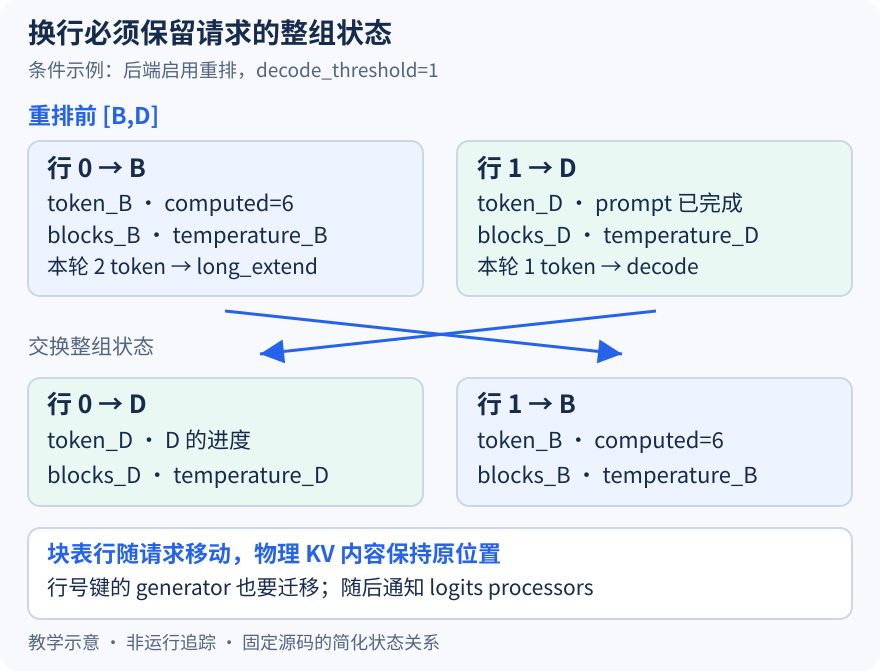

# 把 D 换到第一行，为什么不能只交换两个请求 ID

本文固定 vLLM 提交 `04c1f4a407962a37d01b573f3a2aba91dd2ed3a9`，证据为静态源码分析。数值、状态包与机制图都是教学示意，未运行模型或测量重排成本。源码工作区的未提交本地导读不属于固定提交证据。

上一篇补洞后留下 `[B,D]`。继续设 B 的 prompt 长八，当前计算进度为六，本轮安排两个 token；D 已越过 prompt 阶段，本轮安排一个。这里用普通文本、无推测的同步情形理解字段，computed 在其他配置中可能包含在途工作的乐观进度，不把字段名普遍解释为 GPU 已完成。批次虽然已紧凑，attention 后端仍可能希望把不同工作类型分区组织。

runner 的[_may_reorder_batch](https://github.com/vllm-project/vllm/blob/04c1f4a407962a37d01b573f3a2aba91dd2ed3a9/vllm/v1/worker/gpu_model_runner.py#L1118)只有在 KV 分组存在且重排阈值启用时才走相应路径。若阈值为一，[分类逻辑](https://github.com/vllm-project/vllm/blob/04c1f4a407962a37d01b573f3a2aba91dd2ed3a9/vllm/v1/attention/backends/utils.py#L904)把有上下文、安排数大于一的 B 放入 long_extend，把已有上下文、安排数不超过一且已结束 prefill 的 D 放入 decode。目标区域依次是 decode、short_extend、long_extend、首次 prefill，因而本例可能重排成 `[D,B]`。这是入选请求的执行布局变化，不能解释成调度器重新给 D 分配了优先权，也不是所有后端都必经的排序。

危险在于行号同时索引多种状态。若只把 ID 列表改成 `[D,B]`，却让第一行仍保存 B 的 token 与进度，后续按 D 的安排数取输入时，就可能取出 B 的数据。即便 token 也移动了，若块表仍属于 B，D 的 KV 仍可能写到 B 的物理块。张量的形状、请求数和总 token 数全都正确，也不足以排除这种错配。

图把每行缩写成一个状态包：token 前缀、进度、块号表和采样状态必须共同跟随请求。交换后 D 仍指向自己的块号，B 也仍指向自己的块号，只是行地址互换；图中块号是教学标签，没有模拟真实分配。按 ID 索引的集合或字典则无须仅为换行而改键，区别取决于容器的键，不取决于它是不是 Python 字典。

[swap_states](https://github.com/vllm-project/vllm/blob/04c1f4a407962a37d01b573f3a2aba91dd2ed3a9/vllm/v1/worker/gpu_input_batch.py#L581)先取得两行有效 token 跨度，交换 ID、输出 token 引用、推测 token 列表与 ID 到行的映射，随后搬动长度、计算进度和 token 数据。它仅处理两行所需的有效前缀，避免每次都复制 max_model_len 整行。这里“有效”还计入推测 token 数；本文不用推测配置举例，不代表实现只支持普通 decode。

搬数据还要考虑视图别名。[临时 copy](https://github.com/vllm-project/vllm/blob/04c1f4a407962a37d01b573f3a2aba91dd2ed3a9/vllm/v1/worker/gpu_input_batch.py#L626)先保存其中一行，再覆盖另一行。若照搬标量交换写法，让右侧保留的是底层数组的行视图，第一次赋值就可能改掉第二次赋值要读的原始内容，最后两行都像同一个请求。这里的拷贝保护的是交换语义，不能只凭 Python 多重赋值的外观断言数组交换安全。

接着[块表交换](https://github.com/vllm-project/vllm/blob/04c1f4a407962a37d01b573f3a2aba91dd2ed3a9/vllm/v1/worker/gpu_input_batch.py#L648)保持物理块引用随请求走，temperature、top_p 与惩罚参数等行状态也依次更新。[generators 与 bad_words 的交换](https://github.com/vllm-project/vllm/blob/04c1f4a407962a37d01b573f3a2aba91dd2ed3a9/vllm/v1/worker/gpu_input_batch.py#L686)特别说明：有些字典以行号为键，随机生成器对象必须迁移到新行，不能因为数据不在连续张量中就漏掉。pooling 路径则提前返回，不套用自回归采样状态。

另一类消费者把行状态缓存在自己的内部。交换因此还[登记 SWAP 操作](https://github.com/vllm-project/vllm/blob/04c1f4a407962a37d01b573f3a2aba91dd2ed3a9/vllm/v1/worker/gpu_input_batch.py#L661)，而补洞登记单向移动；最终[refresh_metadata](https://github.com/vllm-project/vllm/blob/04c1f4a407962a37d01b573f3a2aba91dd2ed3a9/vllm/v1/worker/gpu_input_batch.py#L836)把批次更新交给 logits processors，并在批次变化时重建采样元数据。仅检查 InputBatch 自身的数组，仍可能遗漏这些外部消费者的一致性。

验证方案是在 swap_states 前后按 req_id 重新收集 token 前缀、进度、有效块号、temperature 与 generator 对象身份，检查它们是否保持属于同一请求，同时确认 ID 映射确实换行。在 refresh_metadata 处再核对移动通知。若 D 的新行拿到了 B 的块号或生成器，即使模型能运行，也已经推翻一致性假设。本文未执行这些断点，也不从分区存在推断性能收益；重排是否划算仍取决于后端工作与整理成本。
