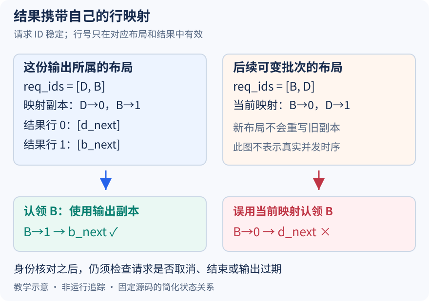

# 行号下一轮会变，旧结果怎样继续找到原来的请求

本文固定 vLLM 提交 `04c1f4a407962a37d01b573f3a2aba91dd2ed3a9`，证据为静态源码分析。跨布局例子与机制图属于教学示意，没有观测真实异步运行、启动 GPU 或测量传输开销。源码工作区另有未提交的本地导读，未作为固定提交证据。

前两篇使 batch 从 `[B,C,D]` 变成 `[B,D]`，并在启用相应后端重排的例子中变为 `[D,B]`。这让行号的性质很清楚：它是某次布局中的地址，不是请求的永久编号。下一步模型输出却仍是按行组织的结果。如果结果对象只保留 token 数组，稍后读取时再去查当前 input_batch 的映射，就可能让两份各自正确的数据组合成错误答案。

把边界具体化。设某次输出布局为 `[D,B]`，结果行是 `[[d_next],[b_next]]`。随后批次对象可能被更新成 `[B,D]`，新的行零属于 B。这里用两次布局解释可变对象的风险，不声称这就是已观测的相邻执行时序，也不声称普通同步配置一定会在消费结果之前重排。若旧结果通过新的 B→0 取 token，B 会认领 d_next；换成新 D→1，D 又认领 b_next。错误发生在对象身份与时间边界，shape 检查不会发现它。

图左侧保存旧结果的行序和映射，右侧表示以后某个时刻的可变批次。蓝色路径始终在旧结果中完成 ID 到行再到 token 的查找；红色路径借用新映射，因此把 B 指向旧数组的第一行。两侧同时画出是为了比较两个版本，不表示执行器允许任意重排正在使用的 GPU 输入。本文只论证 CPU 输出元数据的归属，不展开流同步与在途张量复用协议。

runner 在输出记账时[复制 req_ids 与 req_id_to_index](https://github.com/vllm-project/vllm/blob/04c1f4a407962a37d01b573f3a2aba91dd2ed3a9/vllm/v1/worker/gpu_model_runner.py#L3707)，源码旁明确说明避免返回后被修改，异步调度时尤为重要。复制后的列表与字典固定了这份结果所属的布局；它不是复制整个 InputBatch，也没有宣称冻结所有 token 缓冲、随机状态或 GPU 张量。字符串 ID 和整数下标足以描述这里需要的对应关系，其余数据的生命周期仍由各自路径处理。

[构造 ModelRunnerOutput](https://github.com/vllm-project/vllm/blob/04c1f4a407962a37d01b573f3a2aba91dd2ed3a9/vllm/v1/worker/gpu_model_runner.py#L4747)时，把这些副本与 sampled_token_ids 放进同一个输出对象。[输出类型定义](https://github.com/vllm-project/vllm/blob/04c1f4a407962a37d01b573f3a2aba91dd2ed3a9/vllm/v1/outputs.py#L261)也把请求 ID 列表、ID 到行映射与每请求生成 token 列表区分开，生成数还可能因推测或跳跃解码而不同。这里的结果行按请求索引，与昨天展平的 query token 行不是同一个坐标；B 本轮两个 query 并不要求输出里保留两份请求行。

到了调度器，[update_from_output 中的查找](https://github.com/vllm-project/vllm/blob/04c1f4a407962a37d01b573f3a2aba91dd2ed3a9/vllm/v1/core/sched/scheduler.py#L1976)使用 model_runner_output.req_id_to_index[req_id]，再以该下标取 sampled_token_ids。本例遍历调度计划时即便先看到 B，也会用输出的 B→1 取 b_next，不依赖调度字典插入顺序，更不依赖 worker 下一轮的行序。稳定的请求 ID 连接不同组件，临时行号只在其所属输出内生效。

还有第二道边界：能对回身份，不等于允许接收结果。调度器在索引前[跳过已不存在或已结束的请求](https://github.com/vllm-project/vllm/blob/04c1f4a407962a37d01b573f3a2aba91dd2ed3a9/vllm/v1/core/sched/scheduler.py#L1962)，并有[过期输出丢弃条件](https://github.com/vllm-project/vllm/blob/04c1f4a407962a37d01b573f3a2aba91dd2ed3a9/vllm/v1/core/sched/scheduler.py#L1973)。取消、抢占与恢复的生命周期检查并不会因为映射快照存在就消失。快照回答“这一行当时属于谁”，状态检查回答“这个结果现在还能否推进请求”，两者不能互相代替。

代价是每份输出要保留请求 ID 与映射副本，相关查找和跨进程输出也有开销；当前类型定义说明输出会序列化发送给调度器，并倾向使用列表避免张量序列化成本。本文没有测量这些开销，更不能仅凭几次 copy 判断它是主要瓶颈。

待执行验证可在生成副本、构造 ModelRunnerOutput 和调度器取 req_index 三处观察相同请求。保存旧输出后，让批次经历一次合法的移除或重排，确认旧映射数值不变、对象不同，调度器仍从旧结果的正确行取 token。再取消一个请求，检查它是否在结果认领前被过滤。若旧映射随新批次一起改变，或结果实际按当前批次行认领，就能推翻本文解释。这些是调试方案，尚未形成运行证据。
