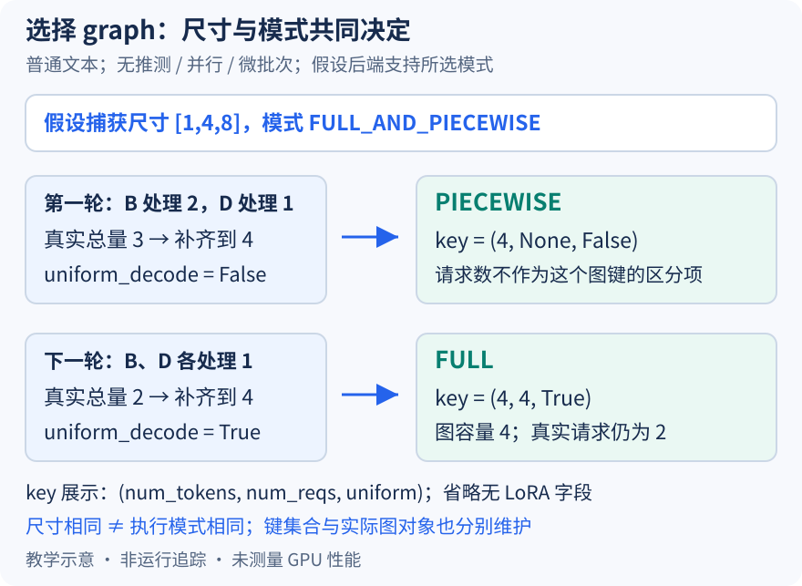

# 真实工作只有三个 token，为什么还要选择四槽图和执行模式

本文固定 vLLM 提交 `04c1f4a407962a37d01b573f3a2aba91dd2ed3a9`，属于静态源码分析。请求、尺寸与机制图都是教学示意，没有捕获 CUDA Graph、运行模型或测量性能。源码工作区另有未提交的本地导读，未作为本文证据。

昨天把请求身份与批次行分开，今天继续追踪同一对 B、D。先设 B 正处理最后两个 prompt token，D 安排一个 decode token，本轮真实工作量为三。下一轮两者都还存活并各安排一个 token，真实工作量变成二。如果为每种真实数量、每种请求分段都维护一张图，覆盖范围会不断扩大；如果只保留一张大图，又可能带来很多无效计算。当前路径在有限尺寸之间归档，再结合执行条件决定用哪种图。

为了手算，本文假设可用捕获尺寸为 `[1,4,8]`、max_num_seqs 至少为四，无 LoRA、推测解码、序列并行、DP 或微批次，并假设后端及编译配置支持 FULL_AND_PIECEWISE。这不是默认尺寸清单，也没有声称任何模型都接受这些条件。[尺寸映射的预计算](https://github.com/vllm-project/vllm/blob/04c1f4a407962a37d01b573f3a2aba91dd2ed3a9/vllm/v1/cudagraph_dispatcher.py#L71)把捕获点之间的数量上取到下一个捕获点，本例三与二都映到四，恰好四则保持四。这个四描述执行容量，没有向调度计划追加真实 token。

但“尺寸都是四”还不足以选择同一条执行路径。[FULL_AND_PIECEWISE 的配置说明](https://github.com/vllm-project/vllm/blob/04c1f4a407962a37d01b573f3a2aba91dd2ed3a9/vllm/config/compilation.py#L629)区分 decode 的整图与混合批次的分段图。分段模式把不兼容的操作留在图外，不能理解成整轮完全没有 graph。runner 的[uniform decode 判断](https://github.com/vllm-project/vllm/blob/04c1f4a407962a37d01b573f3a2aba91dd2ed3a9/vllm/v1/worker/gpu_model_runner.py#L3855)检查最大安排量是否等于 uniform_decode_query_len，以及总量是否等于该长度乘请求数。在普通单 token decode 的本例中 `[2,1]` 不满足，下一轮 `[1,1]` 满足；这首先是工作形状判定，不能仅凭它证明所有请求语义上都已完成 prefill。

图把两轮的真实安排数、补齐尺寸和执行描述符连起来。上一轮得到 PIECEWISE 的 `(4,None,False)`，下一轮得到 FULL 的 `(4,4,True)`；括号依次省略展示 num_tokens、num_reqs 和 uniform，无 LoRA 字段保持相同。None 表示这个分段图键不按请求数细分，并不表示真实请求数未知。FULL 中第二个四是图使用的补齐请求容量，本例真实请求仍只有两个，空行将在下一篇解释。

这些条件由[BatchDescriptor](https://github.com/vllm-project/vllm/blob/04c1f4a407962a37d01b573f3a2aba91dd2ed3a9/vllm/forward_context.py#L30)表达，它是冻结的数据类，用于描述可复用的批次形状。[创建补齐描述符](https://github.com/vllm-project/vllm/blob/04c1f4a407962a37d01b573f3a2aba91dd2ed3a9/vllm/v1/cudagraph_dispatcher.py#L130)时，uniform FULL 情形用补齐 token 数除以每请求 query 长度确定请求容量，并受 max_num_seqs 限制；单 token 情形才有二者相等。涉及推测解码时不能直接把 token 容量当请求数。

[初始化可用键](https://github.com/vllm-project/vllm/blob/04c1f4a407962a37d01b573f3a2aba91dd2ed3a9/vllm/v1/cudagraph_dispatcher.py#L187)会为混合模式建立描述符，并对 PIECEWISE 放宽 num_reqs 与 uniform 条件；decode 分支再建立 FULL 键。键集合表达允许派发的形状，不等于此处已经捕获了 GPU 图。真正的图对象由后续捕获流程生成，不能从集合里有一个键就断言运行已完成准备。

运行时[派发顺序](https://github.com/vllm-project/vllm/blob/04c1f4a407962a37d01b573f3a2aba91dd2ed3a9/vllm/v1/cudagraph_dispatcher.py#L305)先试允许的 FULL 键，再试放宽后的 PIECEWISE 键；都不匹配且允许 NONE 时，就返回原 token 数的无图描述符。过大、尚未初始化或禁用图等情形也会提前返回 NONE。runner 还会因 cascade attention 等条件[排除 FULL](https://github.com/vllm-project/vllm/blob/04c1f4a407962a37d01b573f3a2aba91dd2ed3a9/vllm/v1/worker/gpu_model_runner.py#L3974)，所以仅检查总 token 数不足以推断实际运行模式。NONE 指不使用 CUDA Graph，也不能自动等同于没有模型编译。

归档牺牲部分执行容量，换取有限形状的重复使用；捕获尺寸更密与更稀之间的内存、准备时间和填充代价，需要实际测量。待执行验证可在 dispatch 前后记录真实总量、uniform_decode、allowed_modes、描述符和可用键，保持尺寸清单不变，对照 `[2,1]` 与 `[1,1]`，再排除 FULL。若相同总量和不同条件始终被强行认作同一模式，或返回的图尺寸不是有效捕获点，就能推翻本文解释。本文没有执行这些断点，也不根据模式名估计速度提升。
