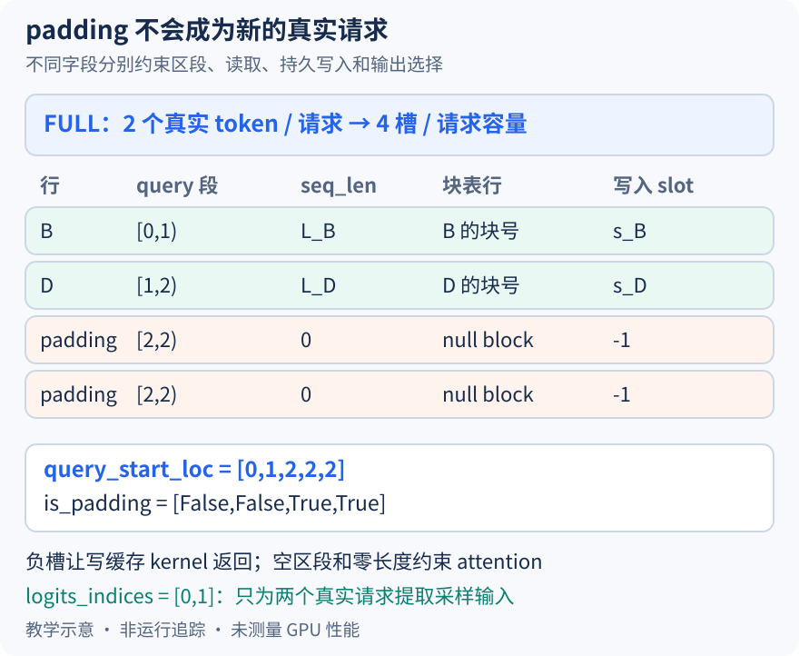

# 两个 decode 请求补成四槽，空出来的行为什么不会写坏 KV

本文基于提交 `04c1f4a407962a37d01b573f3a2aba91dd2ed3a9` 的静态源码分析。数组和图均为教学示意，未执行 CUDA Graph、缓存写入或正确性实验；未提交的本地导读不作为固定提交证据。

接着上一篇第二轮：B、D 各安排一个 token，真实数为二，选择四槽的 FULL 描述符。这里限定普通文本、自回归 full attention、单 rank、同步、无推测和微批次，并假设后端支持所选图。沿用 `[B,D]` 便于画图，若后端重排，请把所有相关数组一起按新行序理解。补齐的第三、四个位置不是另外两个用户请求；系统不能因此给它们分配输出身份或让它们覆盖真实缓存。

最自然但不充分的做法是把补齐 token ID 写成零。零通常仍是可参与模型计算的 ID，不能表达“不许写持久 KV”，也无法定义 attention 应读取多长历史。当前实现把不同副作用拆开约束：真实 query 区间、有效上下文、块表、写入槽和最终采样选择分别维护，而不是靠一个 token 值承担全部屏蔽职责。

先看请求区段。[query_start_loc 的尾部填充](https://github.com/vllm-project/vllm/blob/04c1f4a407962a37d01b573f3a2aba91dd2ed3a9/vllm/v1/worker/gpu_model_runner.py#L2062)重复最后一个真实前缀和值，因此本例在四请求容量下取 `[0,1,2,2,2]`。前两段长度各一，后两段长度为零，数组仍然单调。不能为了凑四就把它补成 `[0,1,2,3,4]`，那相当于在元数据里捏造两个有 query 的请求。token 张量容量四和有效 query 区间之和二，服务的是不同边界。

图按行对齐展示 B、D 和两行 padding，L_B、L_D 表示包含本轮 token 的有效上下文长度，s_B、s_D 是真实物理槽。重复的区段边界、零长度、null block 与负槽是协同约束。图没有声称 padding 不执行任何算术；一些按 token 处理的操作仍可能覆盖四个位置，只是额外位置不能变成真实请求的上下文写入或结果。

[设备 seq_lens 的尾部](https://github.com/vllm-project/vllm/blob/04c1f4a407962a37d01b573f3a2aba91dd2ed3a9/vllm/v1/worker/gpu_model_runner.py#L2181)被清零，本例是 `[L_B,L_D,0,0]`。CPU 的乐观长度也清零，但 computed 在更复杂配置中可能包含在途工作，本文的同步假设不推广成全局完成证明。[构造 attention 元数据时的块表处理](https://github.com/vllm-project/vllm/blob/04c1f4a407962a37d01b573f3a2aba91dd2ed3a9/vllm/v1/worker/gpu_model_runner.py#L2336)将补齐请求行填为 NULL_BLOCK_ID，源码说明零号块保留给 padding。它与有效上下文为零配合，防止先前批次留下的块号继续冒充真实请求历史。

写入端使用另一种哨兵。[slot mapping 的尾部](https://github.com/vllm-project/vllm/blob/04c1f4a407962a37d01b573f3a2aba91dd2ed3a9/vllm/v1/worker/gpu_model_runner.py#L4115)填为 -1，本例得到 `[s_B,s_D,-1,-1]`。负槽并不是“写零号块”，而是交给支持该协议的写缓存实现忽略。例如 [reshape_and_cache_flash_kernel](https://github.com/vllm-project/vllm/blob/04c1f4a407962a37d01b573f3a2aba91dd2ed3a9/csrc/libtorch_stable/cache_kernels.cu#L340)在 slot_idx 小于零时直接返回，不继续计算块号与偏移。仅把块表填零、却保留一个旧的非负写入槽，仍可能污染某个真实块，说明读边界和写边界缺一不可。

还有一个独立的[is_padding 缓冲](https://github.com/vllm-project/vllm/blob/04c1f4a407962a37d01b573f3a2aba91dd2ed3a9/vllm/v1/worker/gpu_model_runner.py#L3474)，在本例为 `[False,False,True,True]`，通过 forward context 交给需要它的组件。它不能替代每个后端自身的长度与槽协议。反过来，也不能因某条 attention 路径靠长度排除了空行，就认定其他跨 token 操作无需认识 padding；正确性要落实到具体消费者。

额外 hidden state 也不自动变成采样对象。无推测路径的[logits_indices](https://github.com/vllm-project/vllm/blob/04c1f4a407962a37d01b573f3a2aba91dd2ed3a9/vllm/v1/worker/gpu_model_runner.py#L2233)来自真实请求区段末端，本例只有 `[0,1]`；模型返回后按这些索引[提取 sample_hidden_states](https://github.com/vllm-project/vllm/blob/04c1f4a407962a37d01b573f3a2aba91dd2ed3a9/vllm/v1/worker/gpu_model_runner.py#L4463)。因此图的四槽容量既没有增加调度 token 预算，也没有生成四个请求的输出身份。

这些规则还受模式约束：runner [以 FULL 判断 attention 是否补齐](https://github.com/vllm-project/vllm/blob/04c1f4a407962a37d01b573f3a2aba91dd2ed3a9/vllm/v1/worker/gpu_model_runner.py#L4302)；PIECEWISE 通常保留真实 attention 维度，单独执行 KV 更新的后端又可能[要求 padded slot mapping](https://github.com/vllm-project/vllm/blob/04c1f4a407962a37d01b573f3a2aba91dd2ed3a9/vllm/v1/worker/gpu_model_runner.py#L4351)。不能把本图所有数组的长度套到每一种配置。填充的计算与内存访问也不是免费的，本文没有测量它们。

待执行验证可从较大真实批次缩到 B、D 两行，重点检查尾部是否残留旧槽号、块号或长度。在元数据构造和缓存 kernel 入口核对图中数组，再检查 logits_indices 不含补齐行；用受控有效槽记录确认负槽没有触发写入。若仅输入尺寸正确，而补齐行仍持有可写真实槽或参与结果认领，就足以推翻解释。这里给出的是实验方案，尚无 GPU 运行观察。
