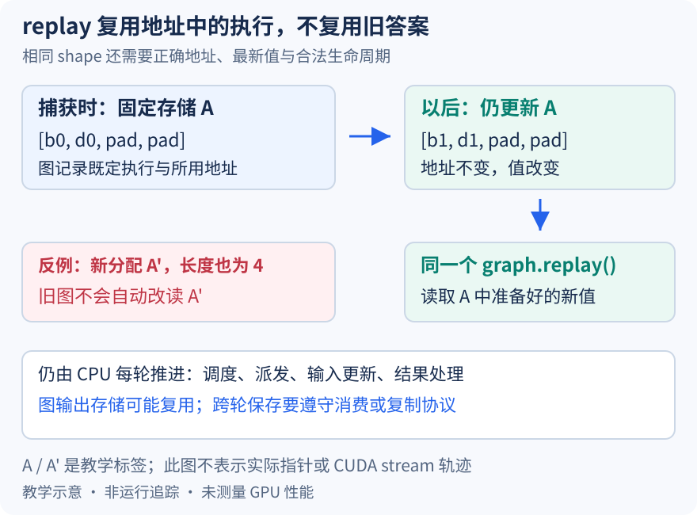

# 请求与 token 都变了，为什么同一张图还能继续 replay

本文固定 vLLM 提交 `04c1f4a407962a37d01b573f3a2aba91dd2ed3a9`，证据为静态源码分析。地址字母、时间关系和机制图为教学示意，没有执行 capture、replay、并发实验或性能测量。未提交的本地导读不属于固定提交证据。

前两篇把 B、D 的两条真实输入放进四槽 FULL 图，并用元数据隔离 padding。下一轮二者的 token、位置和上下文又变了，为什么无需把同一图从头捕获？关键在于图复用的不是“上次的回答”，而是既定执行关系及其存储地址。请求可以在 CPU 批次中移动，持久 GPU 输入缓冲则在每轮装入与本次行序匹配的新值。

runner 初始化时建立[持久输入缓冲](https://github.com/vllm-project/vllm/blob/04c1f4a407962a37d01b573f3a2aba91dd2ed3a9/vllm/v1/worker/gpu_model_runner.py#L792)，包括 input_ids、positions、query_start_loc、seq_lens 等。普通同步输入路径[向已有 GPU 缓冲复制 token](https://github.com/vllm-project/vllm/blob/04c1f4a407962a37d01b573f3a2aba91dd2ed3a9/vllm/v1/worker/gpu_model_runner.py#L1790)，纯文本预处理再[取得其指定长度切片](https://github.com/vllm-project/vllm/blob/04c1f4a407962a37d01b573f3a2aba91dd2ed3a9/vllm/v1/worker/gpu_model_runner.py#L3601)。这里每次新建 Python 切片对象，不等于每次分配新的底层 token 存储。异步模式可能从前一轮设备采样结果整理输入，本文不把这一分支简化成每轮都从 CPU 完整搬运。

图把输入存储标成地址 A。捕获时 B、D 使用值 b0、d0；后续运行先把 b1、d1 放到 A，再让同一图读取。右侧反例给新分配命名 A'：即使长度仍为四、变量名也仍叫 input_ids，旧图并不会因为 Python 变量改绑就自动改读 A'。字母不是实际地址，箭头也不代表测得的 CUDA stream 时间线；它只解释为何形状相同仍不足以保证 replay 正确。

执行模式和描述符经 forward context 传到 [CUDAGraphWrapper.__call__](https://github.com/vllm-project/vllm/blob/04c1f4a407962a37d01b573f3a2aba91dd2ed3a9/vllm/compilation/cuda_graph.py#L235)。模式为 NONE 或与该 wrapper 不符时，它调用底层 runnable；模式匹配时，才按 BatchDescriptor 找具体条目。这使外层派发与实际图对象分工明确：前者选允许复用的条件，后者持有捕获产物。昨天复制的是输出的请求映射，今天复用的是设备执行存储，二者各自解决不同的生命周期问题。

条目尚无图时，wrapper 先验证当前允许捕获，记录位置参数中张量的地址，再在[torch.cuda.graph 上下文内运行 runnable](https://github.com/vllm-project/vllm/blob/04c1f4a407962a37d01b573f3a2aba91dd2ed3a9/vllm/compilation/cuda_graph.py#L315)，保存图与输出引用。这不是把整个调度循环录进去：队列选择、请求 ID 变化、输入准备和调度器结果处理仍由相应 CPU 路径推进。下一次命中已有条目时，[replay 分支](https://github.com/vllm-project/vllm/blob/04c1f4a407962a37d01b573f3a2aba91dd2ed3a9/vllm/compilation/cuda_graph.py#L362)直接调用图并返回保存的输出引用，不再通过这条分支重新执行 runnable 的 Python 函数体。

“没有条目就现场抓一张”也不是常规推理的无条件后备方案。启动捕获流程遍历描述符准备图，完成后[关闭全局捕获许可](https://github.com/vllm-project/vllm/blob/04c1f4a407962a37d01b573f3a2aba91dd2ed3a9/vllm/v1/worker/gpu_model_runner.py#L6840)。若随后意外走到捕获路径，[许可校验](https://github.com/vllm-project/vllm/blob/04c1f4a407962a37d01b573f3a2aba91dd2ed3a9/vllm/compilation/monitor.py#L90)会报错。dispatcher 能派出某个键，与 wrapper 中确实已准备好对应图，是两个需要一致的条件。

输出也有地址复用边界。[entry.output 的保存](https://github.com/vllm-project/vllm/blob/04c1f4a407962a37d01b573f3a2aba91dd2ed3a9/vllm/compilation/cuda_graph.py#L338)使用弱引用包装，捕获输出由图内存池管理。不能把返回值默认理解成可永久保留的独立数值快照；若跨后续 replay 比较两轮结果，应先建立明确的消费或复制协议，避免把被复用的底层存储误认作两份历史输出。输入值更新也必须遵守既有 stream 依赖，持久地址本身不提供任意并发写入的安全性。

调试模式有[输入地址一致性断言](https://github.com/vllm-project/vllm/blob/04c1f4a407962a37d01b573f3a2aba91dd2ed3a9/vllm/compilation/cuda_graph.py#L348)，但它只枚举 args 中直接出现的张量，不能据此宣称 kwargs、嵌套结构与所有 attention 元数据都已自动核验。有效验证应在目标路径同时记录描述符、真正的输入指针、更新后的值和图条目，区分 Python 对象身份与 data_ptr。

待执行方案是在同一四槽 FULL 条目上连续运行两组合法输入，先确认指针保持、值与输出改变，再与同配置的无图路径比较真实行输出。若更新 A 后 replay 仍稳定读取旧值，或改绑新分配后检查体系却错误地认为地址未变，就可反驳对应解释。比较时应在下一次复用前保存需要的结果，并控制数值误差。图可能节省逐次提交工作的开销，但捕获、图内存、填充与外围 CPU 工作仍有代价；本文没有给出任何加速比或运行结论。
