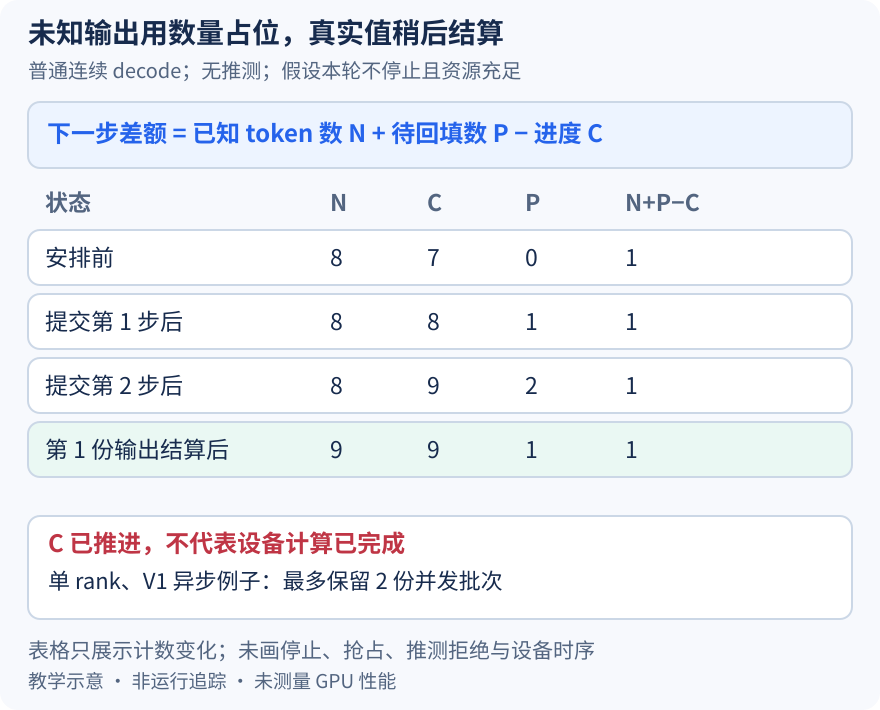

# CPU 还不知道下一个 token，调度器为什么已经能安排下一轮

本文固定 vLLM 提交 `04c1f4a407962a37d01b573f3a2aba91dd2ed3a9`，证据为静态源码分析。计数、队列和机制图属于教学示意，没有运行异步推理或测量重叠收益。源码工作区另有未提交的本地导读，未作为本文证据。

昨天把 B、D 的输入放进固定地址缓冲区，但没有展开下一轮的数据何时可用。若每次都等 CPU 收到采样 token、更新请求、再安排下一次 decode，整个控制循环很容易把等待放在关键路径上。异步调度先回答“下一步需要多少个位置”，把“这些位置最终是什么 token”留给 worker 的设备数据路径。这里限定 V1 GPUModelRunner、单 rank、普通自回归文本、无推测和结构化输出，并假设长度与资源预算充足，不将结论套到所有 runner。

数量信息来自 num_output_placeholders，而不是猜测具体词元。设调度器已知 B 有八个 token，计算进度为七，没有待回填输出；这里八包含已知 prompt 与输出，不要求 prompt 本身长八。无推测时，[num_tokens_with_spec](https://github.com/vllm-project/vllm/blob/04c1f4a407962a37d01b573f3a2aba91dd2ed3a9/vllm/v1/request.py#L295)就等于已知 token 数。[调度差额](https://github.com/vllm-project/vllm/blob/04c1f4a407962a37d01b573f3a2aba91dd2ed3a9/vllm/v1/core/sched/scheduler.py#L650)是 `[已知数 + 待回填数 - 计算进度]`，起初 `8+0-7=1`，所以本轮安排一个输入位置。

[基础调度器的安排后更新](https://github.com/vllm-project/vllm/blob/04c1f4a407962a37d01b573f3a2aba91dd2ed3a9/vllm/v1/core/sched/scheduler.py#L1578)立即推进 num_computed_tokens 并增加 num_in_flight_tokens；随后 [AsyncScheduler 的更新](https://github.com/vllm-project/vllm/blob/04c1f4a407962a37d01b573f3a2aba91dd2ed3a9/vllm/v1/core/sched/async_scheduler.py#L39)为将要生成的输出增加占位数量。本例已知数仍八，进度变八，待回填数变一，下一次差额仍是 `8+1-8=1`。若只看已知数与进度，就会错误地认为 B 已经没有工作。

图继续安排下一步后得到已知八、进度九、待回填二。旧的第一份结果返回并被接受时，已知数增到九，待回填减到一，进度仍为九；差额 `9+1-9` 仍为一。这个变化展示的是计数守恒，不是两轮 GPU 已同时完成的证明，也没有展示任意数量的超前安排。num_computed_tokens 在这里明确包含已安排但尚未结算的工作，不能直接作为完成时间线。

占位只在适当边界增加。异步更新先调用基础实现判断 is_prefill_chunk，仍是中间 prefill chunk 就跳过输出占位；到达应生成结果的步骤才计入预期采样数。真实结果进入[请求输出更新](https://github.com/vllm-project/vllm/blob/04c1f4a407962a37d01b573f3a2aba91dd2ed3a9/vllm/v1/core/sched/async_scheduler.py#L51)时，先由基础逻辑追加 token 并检查停止，再对非过期输出扣减相应占位数。旧结果若属于抢占前的工作，不能直接从已被清理的占位数继续减，否则可能下溢。

这套数量账也限制 KV 的公开边界。异步实现调用 cache_blocks 时[扣除 num_output_placeholders](https://github.com/vllm-project/vllm/blob/04c1f4a407962a37d01b573f3a2aba91dd2ed3a9/vllm/v1/core/sched/async_scheduler.py#L67)，没有把所有乐观进度都直接交给缓存登记。这个参数表达实现采用的缓存边界，仍不能单凭减法声称某个 GPU 写入已经完成；真实设备依赖由执行协议保障。计算进度、输出结算和可复用缓存的边界必须分别追踪。

超前也有明确上限。这个 runner 的单 rank 异步配置将[并发批次数设为二](https://github.com/vllm-project/vllm/blob/04c1f4a407962a37d01b573f3a2aba91dd2ed3a9/vllm/config/vllm.py#L589)。EngineCore 的队列路径先提交新批次，再把 future 与原始调度计划[一起入队](https://github.com/vllm-project/vllm/blob/04c1f4a407962a37d01b573f3a2aba91dd2ed3a9/vllm/v1/engine/core.py#L729)，容量尚有余地时可以先返回；达到边界时从另一端取最老批次，等待结果并结算。这是在控制面保留有限在途工作，不意味着两个 GPU kernel 一定并行执行。

还有请求自身的停止约束。[接近 max_tokens 的检查](https://github.com/vllm-project/vllm/blob/04c1f4a407962a37d01b573f3a2aba91dd2ed3a9/vllm/v1/core/sched/scheduler.py#L611)会结合占位与乐观进度避免确定多余的安排，token 和 KV 预算也照常生效。异步留下的是可重叠的准备窗口，代价是更多在途状态、停止与抢占后的结算复杂度，本文不推断具体吞吐收益。

待执行验证可在两次 schedule 返回及第一次 update_from_output 后，按同一个 req_id 记录 num_tokens、num_computed_tokens、num_output_placeholders、num_in_flight_tokens 和队列深度，再观察是否符合图中的普通 decode 计数。若未接收输出却把占位解释成真实 token，或结算后占位为负，就能推翻相关不变量。不要用调度日志的先后代替 GPU 完成事件；本文未执行这些断点。下一篇追踪 B 的真实 token 值怎样在设备上补进输入。
