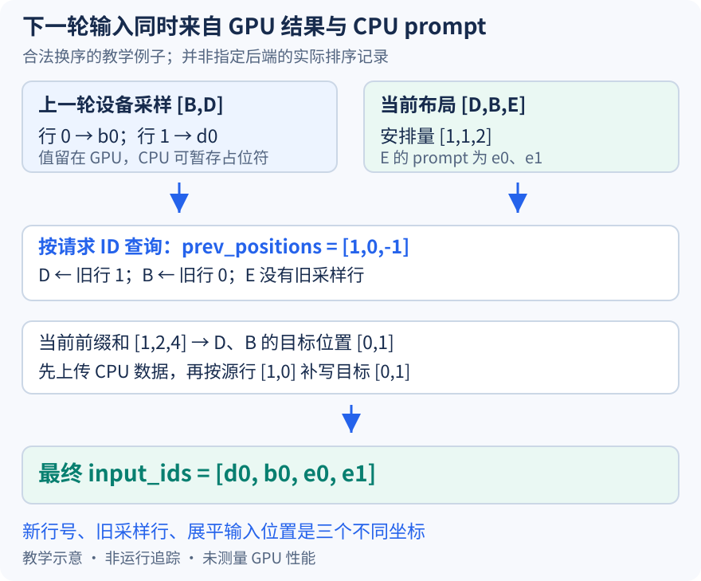

# CPU 缓冲里还是占位符，下一轮输入怎样拿到真实采样 token

本文固定 vLLM 提交 `04c1f4a407962a37d01b573f3a2aba91dd2ed3a9`，属于静态源码分析。请求重排、索引与 token 标签为教学示意，没有执行 GPU scatter、模型推理或性能测试。未提交的本地导读不属于固定提交证据。

上一篇说明调度器可以先确定下一轮安排量，但模型绝不能把“尚未知晓的 token”当作词表输入。继续设 B、D 上一轮各生成一个 token，设备采样结果按当时的 `[B,D]` 两行存成 `[[b0],[d0]]`。CPU 不必先把这两个值收回来再发一次；worker 保留设备结果，按新一轮的请求身份把值放进固定 input_ids 缓冲。这与昨天图的固定地址约束衔接：地址可以保留，里面的值必须在使用前更新正确。

在异步记账分支，runner [保存上一轮设备采样张量与请求映射](https://github.com/vllm-project/vllm/blob/04c1f4a407962a37d01b573f3a2aba91dd2ed3a9/vllm/v1/worker/gpu_model_runner.py#L3747)，映射排除不应接受本轮采样的行。与此同时，[CPU 侧记录可能先放入 -1](https://github.com/vllm-project/vllm/blob/04c1f4a407962a37d01b573f3a2aba91dd2ed3a9/vllm/v1/worker/gpu_model_runner.py#L3763)，以维护 token 数和后续状态。这是词元值的占位表示，既不是调度器的占位计数本身，也不是昨天用于阻止 KV 写入的负 slot；三者所在的数据结构和消费者不同。

若相邻批次行序相同，直接把上一轮采样第一列复制到当前输入前缀就很自然。但请求可能移走、加入或重排，沿用旧行号会把 b0 交给 D。runner 因此通过[_compute_prev_positions](https://github.com/vllm-project/vllm/blob/04c1f4a407962a37d01b573f3a2aba91dd2ed3a9/vllm/v1/worker/gpu_model_runner.py#L1754)按当前 ID 查上一轮行号，新请求记为 -1。这个数组从“当前请求行”指回“旧采样行”，方向不能倒过来。

图假设当前合法布局变成 `[D,B,E]`，每请求安排量是 `[1,1,2]`，E 的两个 prompt token 已在 CPU。上一轮映射是 B→0、D→1，故 prev_positions 为 `[1,0,-1]`；当前前缀和为 `[1,2,4]`。D 的目标扁平位置是零，B 是一，E 占位置二、三。最终输入应为 `[d0,b0,e0,e1]`，不是按旧采样行直接拼出的 `[b0,d0,e0,e1]`。布局只用于展示合法映射关系，不声称某个后端必然产生这个排列。

[_prepare_input_ids 的索引构造](https://github.com/vllm-project/vllm/blob/04c1f4a407962a37d01b573f3a2aba91dd2ed3a9/vllm/v1/worker/gpu_model_runner.py#L1811)同时保留旧采样行与新目标位置。无推测时，新目标是该请求累计安排量减一；旧源行取 prev_positions。这里每个连续 decode 请求只有一个本轮输入，所以目标正是它的区段位置。带推测 token 的路径还要扣 draft_len、整理草稿索引，不能把本例的两元素关系直接覆盖多 token 验证布局。

因为 E 不是上一轮的连续 decode，请求总输入又包含它的 prompt，[实现先上传 CPU 输入缓冲](https://github.com/vllm-project/vllm/blob/04c1f4a407962a37d01b573f3a2aba91dd2ed3a9/vllm/v1/worker/gpu_model_runner.py#L1851)，再把 B、D 的占位位置替换掉。上传的是准备过程中的中间值，不表示 -1 会被当成正常词元送进 embedding；必须在模型消费前完成设备补写。E 的数据来自 CPU，B、D 的实际采样值来自 GPU，两路在同一个持久输入缓冲汇合。

行号与目标位置满足连续对应时，[快速路径](https://github.com/vllm-project/vllm/blob/04c1f4a407962a37d01b573f3a2aba91dd2ed3a9/vllm/v1/worker/gpu_model_runner.py#L1861)用一次切片 copy；本例发生换序，则走[索引 scatter](https://github.com/vllm-project/vllm/blob/04c1f4a407962a37d01b573f3a2aba91dd2ed3a9/vllm/v1/worker/gpu_model_runner.py#L1878)，源行 `[1,0]` 写入目标 `[0,1]`。新请求没有上一轮来源，不参与这次补写。没有任何共同请求时，上传 CPU 数据后即可返回。

这条路径避免为准备 decode 输入而强制经历“设备采样值回 CPU、再传回设备”的往返，但不等于所有 CPU 消费者都不再需要同步；某些 logits processors 仍需真实输出历史。它也没有消除自回归依赖：先生成 b0，才能用 b0 做下一步输入，设备执行仍须遵守已有 stream 顺序。减少控制面的等待与让同一请求两步计算随意并发，是不同命题。

待执行验证可在旧采样缓存、prev_positions 生成、CPU 上传和 scatter 后分别观察同一批次，记录源值、源行、目标位置与最终 input_ids。先保持行序，再交换 B、D 并加入 E，检查是否只改变索引而不改变 token 归属。若 shape 都正确却出现 `[b0,d0,e0,e1]`，就能直接推翻身份对齐解释。本文只给出断点方案，尚无运行或加速数据。
