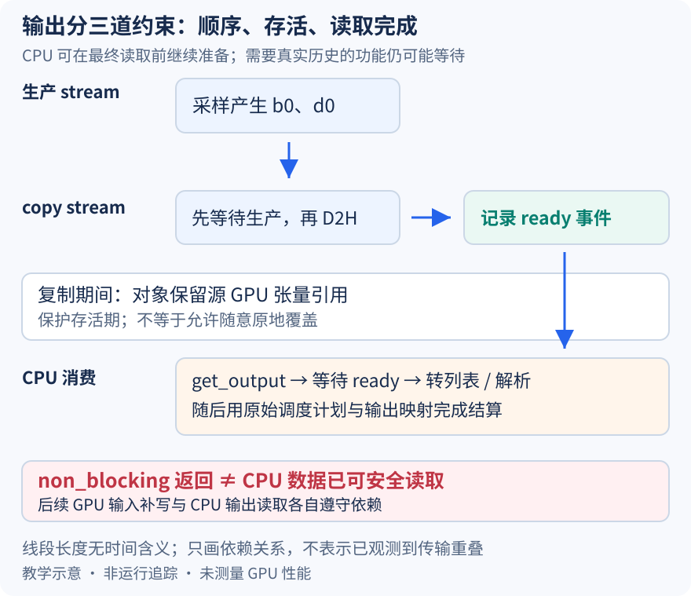

# 下一轮已经准备好了，上一轮 CPU 输出为什么还得等一个事件

本文基于提交 `04c1f4a407962a37d01b573f3a2aba91dd2ed3a9` 的静态源码分析。stream、事件和时间关系都是教学示意，未测量真实重叠、PCIe 传输或端到端延迟。未提交的本地导读不作为固定提交证据。

前两篇让调度器先安排数量、让 worker 直接使用 GPU 上的 b0、d0 准备下一轮。但客户端输出、停止判断和部分采样逻辑最终仍需要 CPU 上的实际 token。如果把 non_blocking=True 理解为“调用返回以后主机数据就可读”，异步拷贝只会把原来的等待变成错误读取。这里继续限定 V1 runner 的普通单 rank 自回归路径，分别追踪生产顺序、源张量存活和 CPU 读取时机。

runner 将采样结果包装为 [AsyncGPUModelRunnerOutput](https://github.com/vllm-project/vllm/blob/04c1f4a407962a37d01b573f3a2aba91dd2ed3a9/vllm/v1/worker/gpu_model_runner.py#L4767)，而不是当场把 token 全部转成 Python 列表。包装对象先[持有设备张量引用](https://github.com/vllm-project/vllm/blob/04c1f4a407962a37d01b573f3a2aba91dd2ed3a9/vllm/v1/worker/gpu_model_runner.py#L302)，避免源对象在主机拷贝完成前被释放。引用保护的是存活期，不是阻止所有原地写入的锁，也不能独自保证另一个 stream 已经完成生产。

生产依赖由另一道机制建立。[输出 copy stream 等待当前生产 stream](https://github.com/vllm-project/vllm/blob/04c1f4a407962a37d01b573f3a2aba91dd2ed3a9/vllm/v1/worker/gpu_model_runner.py#L311)，然后提交 token 和需要的 logprob 等非阻塞主机拷贝，最后[记录 copy-ready 事件](https://github.com/vllm-project/vllm/blob/04c1f4a407962a37d01b573f3a2aba91dd2ed3a9/vllm/v1/worker/gpu_model_runner.py#L328)。等待关系要求先有采样值，再复制；事件标记拷贝侧完成点，不表示设备上的未来所有工作都已结束。包装对象返回时，只能确认这些依赖与操作已被安排，不能认定主机 token 数组已经可安全读取。

图的生产流生成 b0、d0 后，既可为后续设备输入提供来源，也可被 copy stream 复制。CPU 可以在获取最终输出前做允许的准备工作，真正读取时必须跨过 ready 事件。图中的并列只表示可能重叠的窗口；线段长度没有时间单位，不声称硬件一定同时执行复制与计算，也没有表示同一张量可以在被复制时任意覆盖。

CPU 消费入口是[get_output](https://github.com/vllm-project/vllm/blob/04c1f4a407962a37d01b573f3a2aba91dd2ed3a9/vllm/v1/worker/gpu_model_runner.py#L330)。它先 synchronize 对应事件，再释放保留的 token 与 logprob 设备引用，之后才 tolist 或解析结果、过滤无效请求行并填入 ModelRunnerOutput。同步针对这个拷贝完成点，不是直接调用全设备同步。因而三道约束不能互换：wait_stream 保证源值生产顺序，持有引用保证源对象存活，事件等待保证 CPU 在合法时机读取。

以 UniProcExecutor 为具体边界，[non_block 分支](https://github.com/vllm-project/vllm/blob/04c1f4a407962a37d01b573f3a2aba91dd2ed3a9/vllm/v1/executor/uniproc_executor.py#L108)仍会调用 worker 方法，但返回异步输出时把它包成 AsyncOutputFuture。[这个 future 的 result 方法](https://github.com/vllm-project/vllm/blob/04c1f4a407962a37d01b573f3a2aba91dd2ed3a9/vllm/v1/executor/uniproc_executor.py#L38)在尚未物化结果时才调用 get_output，并保存结果或异常。因此 non_block 没有承诺所有 CPU 工作都在后台线程执行；这里推迟的是获取完整主机输出所需的等待与转换，也不能只把 Future 的状态当成 CUDA 事件状态。

EngineCore 保存每份输出 future 对应的原始调度计划，[从队尾取最老一份并等待](https://github.com/vllm-project/vllm/blob/04c1f4a407962a37d01b573f3a2aba91dd2ed3a9/vllm/v1/engine/core.py#L744)，再处理期间到达的取消，调用 scheduler.update_from_output。FIFO 结算与此前的请求映射快照一起，确保结果进入所属步骤和请求；事件只解决数据可读，不替代请求身份、取消与过期结果检查。

还有更早的 CPU 消费者。InputBatch 仅在采样元数据需要输出历史时保存主机张量和事件，[update_async_output_token_ids](https://github.com/vllm-project/vllm/blob/04c1f4a407962a37d01b573f3a2aba91dd2ed3a9/vllm/v1/worker/gpu_input_batch.py#L1042)会在 logits processors 使用前等待同一拷贝事件，用实际结果修补 -1 占位。这给“异步永远不等待”一个具体反例：需要真实 CPU 历史的功能可以把等待提前，是否保留重叠窗口取决于真实依赖，不能由配置开关推断。

待执行验证可在包装返回、copy-ready 记录和 get_output 的事件等待前后设置观察点，记录引用存活、事件状态和开始读取列表的位置；再对比是否需要 CPU 输出历史的采样配置。若主机读取发生在完成事件之前，或源对象在拷贝完成前失去必要引用，就能推翻相应生命周期解释。记录时应避免额外全设备同步改变待观察路径；本文没有执行这些实验，也没有把“有两个 stream”当成性能证据。
