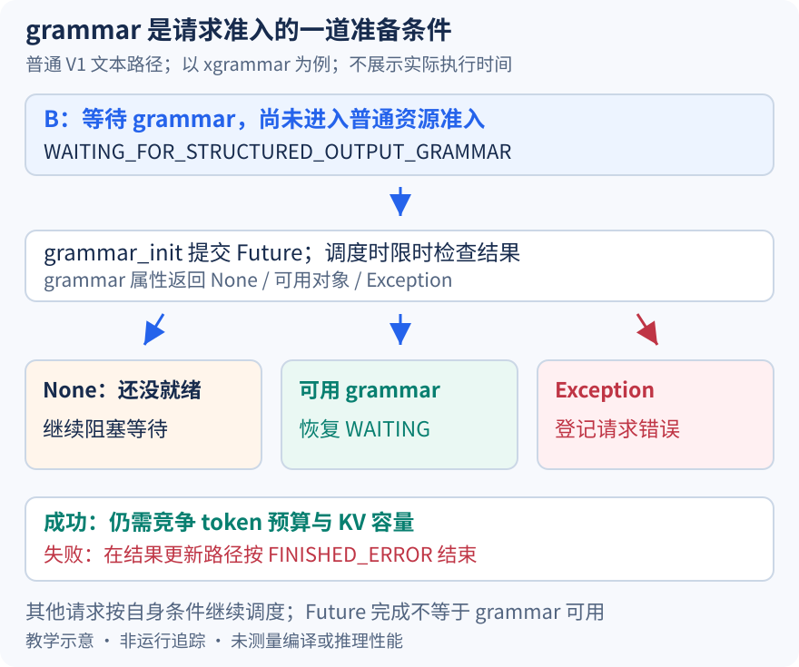

# grammar 还在编译，请求为什么不能直接进入 prefill

本文固定 vLLM 提交 `04c1f4a407962a37d01b573f3a2aba91dd2ed3a9`，证据为静态源码分析。请求、状态与机制图均为教学示意，未启动模型、执行 grammar 编译实验或测量延迟。源码工作区另有未提交的本地导读，未作为本文证据。

10 月 22 日解释了异步执行怎样提前安排数量，今天加入结构化输出。设 B 要求按某个 JSON schema 生成，D 的约束已经准备好，仍在正常 decode。B 的约束需要先转换成后端可使用的 grammar；如果在调度循环里一直等编译结束，D 也可能被迫停下来。反过来，若先让 B 无约束运行、到第一次采样时再查编译结果，又把等待与失败推迟到已经投入计算之后。当前实现选择请求级的准备状态，把 grammar 变成入场条件。

这里追踪 V1、启用 tokenizer 的普通文本路径，以 xgrammar 后端为具体例子，不讨论 reasoning 区段与推测解码。[Request 的初始化](https://github.com/vllm-project/vllm/blob/04c1f4a407962a37d01b573f3a2aba91dd2ed3a9/vllm/v1/request.py#L114)将存在 structured_output_request 的生成请求置为 WAITING_FOR_STRUCTURED_OUTPUT_GRAMMAR。这个状态不只是对外展示的标签：等待队列尝试提升请求状态时，必须先取得可用 grammar，才继续一般的资源准入。因此本路径没有在编译未就绪时先给 B 做普通 prefill 的特殊放行。

[EngineCore 的请求准备入口](https://github.com/vllm-project/vllm/blob/04c1f4a407962a37d01b573f3a2aba91dd2ed3a9/vllm/v1/engine/core.py#L1064)构造 Request 后调用 grammar_init。管理器首次需要时初始化后端，再根据条件[提交编译任务](https://github.com/vllm-project/vllm/blob/04c1f4a407962a37d01b573f3a2aba91dd2ed3a9/vllm/v1/structured_output/__init__.py#L168)，把 Future 放进请求自己的 structured_output_request。编译任务负责返回可操作的 grammar 对象；Future 表达的是准备过程，不是模型计算的 future，也没有预先提供某个输出 token 的合法集合。

图中 B 在编译未完成时留在阻塞等待状态，D 可以继续参与正常调度；成功后 B 先回到 WAITING，再竞争 token 与 KV 容量。两条箭头并不保证 D 一定获得份额，也不意味着 B 一旦编译成功就立即执行。准备就绪只是解除一种阻塞，原有队列策略和资源约束仍然存在。图的失败分支则明确结束该请求，不能把失败当成无约束放行。

检查 Future 时也没有无限等待。[StructuredOutputRequest._check_grammar_completion](https://github.com/vllm-project/vllm/blob/04c1f4a407962a37d01b573f3a2aba91dd2ed3a9/vllm/v1/structured_output/request.py#L44)用 timeout=0.0001 尝试取结果，超时则 grammar 属性返回 None，之后可再检查；成功时将 Future 替换为 grammar，异常时则替换为 Exception。这个超时参数不是编译时限，更不是观测到的检查耗时。Future 已结束和 grammar 可使用是两个判断，不能只看一个 ready 名字就认定约束有效。

[调度器的提升分支](https://github.com/vllm-project/vllm/blob/04c1f4a407962a37d01b573f3a2aba91dd2ed3a9/vllm/v1/core/sched/scheduler.py#L3025)明确区分 None、Exception 与可用对象。None 继续等，Exception 登记到 grammar_compile_error_reqs，只有可用对象才恢复 WAITING；尚不能提升的请求在[队列遍历中暂时跳过](https://github.com/vllm-project/vllm/blob/04c1f4a407962a37d01b573f3a2aba91dd2ed3a9/vllm/v1/core/sched/scheduler.py#L868)。随后结果更新路径会将登记的编译失败[按 FINISHED_ERROR 统一结束](https://github.com/vllm-project/vllm/blob/04c1f4a407962a37d01b573f3a2aba91dd2ed3a9/vllm/v1/core/sched/scheduler.py#L2168)，而不是把整个引擎当成失败。这里解释的是请求编译错误的隔离，不承诺所有初始化异常都经过同一分支。

编译产物还带着后续的请求状态。xgrammar 分支在得到上下文后[构造新的 GrammarMatcher](https://github.com/vllm-project/vllm/blob/04c1f4a407962a37d01b573f3a2aba91dd2ed3a9/vllm/v1/structured_output/backend_xgrammar.py#L123)，它会随着这个请求接受的 token 推进。即便两个请求使用同一规范，也不能仅因规范相同就让它们共享一份正在变化的 matcher；本文没有核验外部库内部的编译缓存策略，不把上下文可能复用推广成状态可以共用。

异步编译还受执行拓扑限制。管理器在[external_launcher 下关闭异步编译](https://github.com/vllm-project/vllm/blob/04c1f4a407962a37d01b573f3a2aba91dd2ed3a9/vllm/v1/structured_output/__init__.py#L53)，源码解释是各 TP rank 的独立调度器若在不同时刻提升状态，会破坏该模式的确定性假设。局部等待更少不一定兼容全局协调，这也说明不能只根据有线程池就断言所有配置都并行编译。

待执行验证可在 grammar_init 返回、grammar 属性检查及状态提升处，观察 B 的 _grammar 类型、请求状态和是否进入本轮调度计划。分别控制未完成、成功和编译异常，再确认 D 仍按自身条件参与调度。若 Future 超时仍让 B 进入计算，或异常请求转为普通无约束生成，就能推翻本文的准入解释。本文未执行这些断点，也没有给出编译耗时或吞吐收益。
