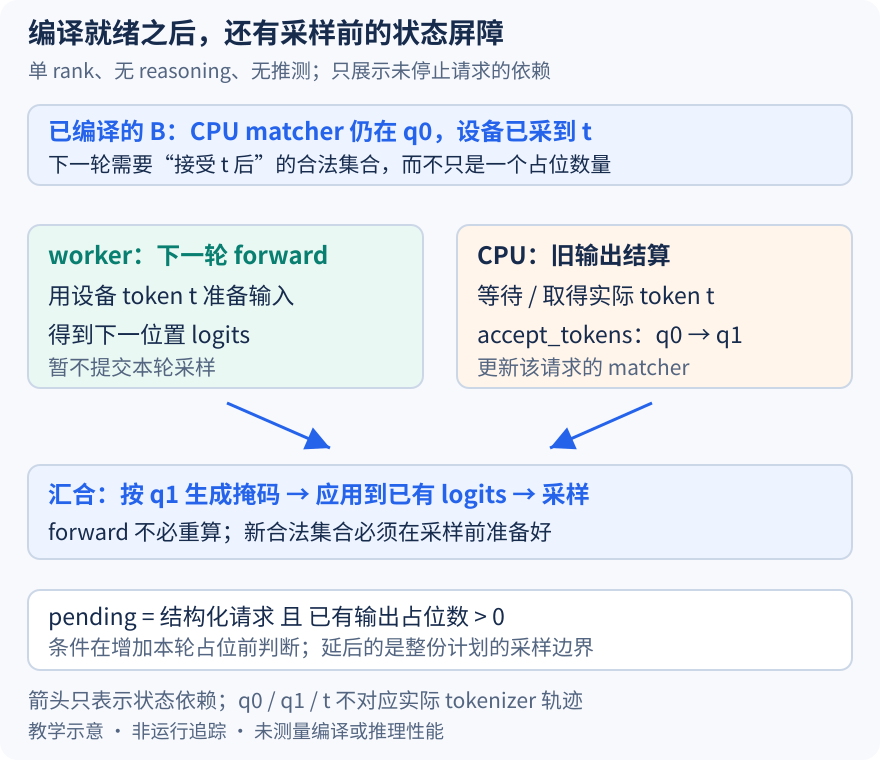

# grammar 已经编译好，为什么 forward 能先跑而采样还要等

本文固定 vLLM 提交 `04c1f4a407962a37d01b573f3a2aba91dd2ed3a9`，属于静态源码分析。状态 q0、q1、token 标签与机制图为教学示意，未运行异步采样、检查模型输出或测量重叠。未提交的本地导读不作为固定提交证据。

上一篇让 B 取得可用 grammar 并进入普通调度，但编译完成并不意味着之后每一轮都无需等待。grammar 描述规则，matcher 还记录这个请求已接受的输出前缀。10 月 22 日的异步路径允许 worker 使用设备上的上一轮采样值准备下一轮输入；CPU 上负责推进 grammar 的调度器，却可能尚未结算那份输出。于是同一请求出现两种进度：模型可以继续 forward，下一次采样的合法集合还没有更新。

设 B 的 matcher 当前在 q0，上一轮实际采到了 token t，设备已经持有 t。下一轮 forward 可以把 t 作为输入，得到“t 之后”的候选 logits；但约束仍停在“t 之前”的 q0。若直接用 q0 的掩码采样，就会把前一个前缀对应的合法集合误用到新位置。q0 接受 t 后到达 q1，q1 的合法集合可以与 q0 不同。这个例子只表达状态依赖，不对应某个真实 tokenizer 的字符切分，也不声称任何 JSON 标点必然是单 token。

这里限定 V1 GPUModelRunner、单 rank、普通自回归结构化输出，无 reasoning 区段和推测解码。关键触发条件来自[AsyncScheduler._update_after_schedule](https://github.com/vllm-project/vllm/blob/04c1f4a407962a37d01b573f3a2aba91dd2ed3a9/vllm/v1/core/sched/async_scheduler.py#L31)：请求使用结构化输出，而且已有 num_output_placeholders 大于零，才把本轮 pending_structured_output_tokens 置真。检查发生在增加本轮占位之前，所以不是“有结构化请求就总要延后采样”，也不是当前刚增加的占位把自己挡住。

图中左侧允许下一轮 forward 使用设备 token t，右侧等 CPU 收到上一轮输出后，将 matcher 从 q0 推到 q1。两条路径在构造 q1 掩码并采样的位置汇合。线段不表示实测时长或 kernel 并发；它只是强调 forward 的输入依赖与 grammar 掩码的状态依赖可以在不同边界满足。等待没有消失，而是放在真正需要新合法集合的采样入口。

EngineCore 先[提交 execute_model](https://github.com/vllm-project/vllm/blob/04c1f4a407962a37d01b573f3a2aba91dd2ed3a9/vllm/v1/engine/core.py#L703)，随后才检查 pending 标记。没有待结算的结构化输出时可以取得掩码并立即提交采样；否则[保存 deferred_scheduler_output](https://github.com/vllm-project/vllm/blob/04c1f4a407962a37d01b573f3a2aba91dd2ed3a9/vllm/v1/engine/core.py#L713)，暂不调用本轮 sample_tokens。这个标记属于整份调度计划，当前代码沿批次采样边界延后处理，不是只对 B 单独插入一个 GPU 局部等待。混合批次中的其他请求也要结合这个边界理解。

接着 EngineCore [取最老输出并更新调度器](https://github.com/vllm-project/vllm/blob/04c1f4a407962a37d01b573f3a2aba91dd2ed3a9/vllm/v1/engine/core.py#L744)。结果处理不仅回填 token 和占位数量，还会把实际输出交给[structured_output_manager.accept_tokens](https://github.com/vllm-project/vllm/blob/04c1f4a407962a37d01b573f3a2aba91dd2ed3a9/vllm/v1/core/sched/scheduler.py#L2057)。在本文没有 reasoning 分段的条件下，这些已接受 token 推进对应请求的 matcher；xgrammar 包装器[逐 token 调用 accept_token](https://github.com/vllm-project/vllm/blob/04c1f4a407962a37d01b573f3a2aba91dd2ed3a9/vllm/v1/structured_output/backend_xgrammar.py#L157)，并维护 num_processed_tokens 与结束状态。若约束反而拒绝实际输出，调度器会结束错误请求，不能静默当成状态已经推进。

完成旧结果结算以后，EngineCore 才[为 deferred 计划生成 grammar_bitmask 并提交采样](https://github.com/vllm-project/vllm/blob/04c1f4a407962a37d01b573f3a2aba91dd2ed3a9/vllm/v1/engine/core.py#L781)。worker 的执行状态保留了 forward 产生的 logits；在 sample_tokens 中，[先应用掩码，再调用采样器](https://github.com/vllm-project/vllm/blob/04c1f4a407962a37d01b573f3a2aba91dd2ed3a9/vllm/v1/worker/gpu_model_runner.py#L4562)。因此这里不是把下一轮整个 forward 重新计算一遍，而是在已有模型结果进入选择步骤前，补齐其依赖的 grammar 状态。

这也解释了为什么占位数量不能替代真实 token。知道还有一个输出未结算，足以支持部分数量决策，却不足以知道 matcher 应走哪条转移边。num_computed_tokens 仍可能包含在途工作的乐观进度，它与 matcher.num_processed_tokens 的物理含义不同，不能通过让两个数相等来“修复”状态。若启用推测解码或 reasoning，掩码可能涉及多位置状态试探或约束起点，本文没有将它们压成单步 q0→q1。

代价是 CPU grammar 状态更新成为采样前的依赖，保留的 logits 与 deferred 计划也有生命周期；能够重叠多少 forward 和状态处理需要测量。待执行验证可在 pending 标记、execute_model、旧输出 accept_tokens 和 deferred 掩码生成处记录同一 req_id 的占位数、已接受 token 与 matcher 进度。若新位置掩码在旧 token 被接受前就按旧状态生成，或本轮占位一增加就无条件触发等待，就能反驳对应解释。本文未运行这些断点或报告性能结果。
