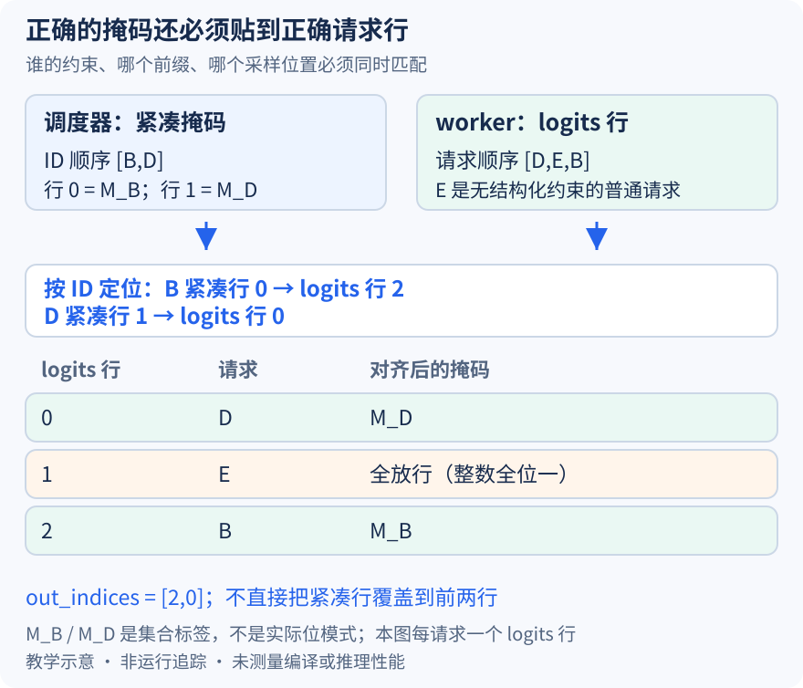

# 合法 token 集合算对了，为什么仍可能约束错请求

本文基于提交 `04c1f4a407962a37d01b573f3a2aba91dd2ed3a9` 的静态源码分析。行号、掩码标签与图为教学示意，没有运行掩码 kernel、grammar 库或输出正确性测试。未提交的本地导读不作为固定提交证据。

前两篇让 B 的 grammar 准备好，并在上一轮 token 被接受后生成新状态的约束。还有最后一个边界：调度器只发送需要约束的请求，worker 却对整批 logits 采样，而且两个组件的请求顺序未必相同。即使 B、D 的合法 token 集合都算对，只要掩码贴错行，仍会把两个请求互相限制，甚至让普通请求 E 无端失去候选。

设本轮 B、D 都是结构化请求，E 是普通请求，三者各有一个用于采样的 logits 行。调度器收集顺序为 `[B,D]`，发送两行 `[M_B,M_D]`；worker 当前行序是 `[D,E,B]`。本文限定普通自回归、无推测、无 reasoning，并假设 B、D 均在应采样的步骤。M_B、M_D 只是合法集合的标签，不代表某个真实 schema 的位模式，也没有把输入 token 行与采样 logits 行当成普遍一一对应。

[Scheduler.get_grammar_bitmask](https://github.com/vllm-project/vllm/blob/04c1f4a407962a37d01b573f3a2aba91dd2ed3a9/vllm/v1/core/sched/scheduler.py#L1876)先过滤不存在的请求、没有结构化输出的请求与尚在中间 prefill chunk 的请求。掩码连同 structured_output_request_ids 一起形成 GrammarOutput，所以它自带紧凑行的身份顺序。它不是把整批请求都补齐成同样大小再发送，worker 也不能直接假定紧凑行零就是自己 logits 行零。

管理器按这个 ID 顺序填充掩码，xgrammar 包装器通过[fill_next_token_bitmask](https://github.com/vllm-project/vllm/blob/04c1f4a407962a37d01b573f3a2aba91dd2ed3a9/vllm/v1/structured_output/backend_xgrammar.py#L208)从请求 matcher 的当前状态取得下一位置约束。管理器使用可复用缓冲，并在返回前[截取有效行再转换为 NumPy](https://github.com/vllm-project/vllm/blob/04c1f4a407962a37d01b573f3a2aba91dd2ed3a9/vllm/v1/structured_output/__init__.py#L429)，源码说明转换是为了向 worker 序列化更高效。这个转换不改变每行归属；元数据仍需跟随数组一起传递。

图中紧凑行零的 M_B 被搬到 logits 行二，紧凑行一的 M_D 被搬到行零；行一属于 E，保持全放行。若直接把两行覆盖 worker 前两行，就会把 M_B 贴给 D、把 M_D 贴给 E，B 反而未得到正确约束。错误不一定造成 shape 异常：请求数、词表宽度甚至掩码内容都可能完全合法，问题是它们之间的映射错了。

[apply_grammar_bitmask 的行索引构造](https://github.com/vllm-project/vllm/blob/04c1f4a407962a37d01b573f3a2aba91dd2ed3a9/vllm/v1/structured_output/utils.py#L129)遍历 input_batch.req_ids，按请求 ID 记录目标 logits 行。无推测时目标就是 batch_index；有推测时还累加此前请求的草稿 token 数，因为一个请求可能拥有多个候选位置，不能把请求行号直接推广成最终 logits 行号。今天先保留这个边界，不展开多位置掩码的试探与回滚。

随后实现[创建与 logits 行数对齐的缓冲](https://github.com/vllm-project/vllm/blob/04c1f4a407962a37d01b573f3a2aba91dd2ed3a9/vllm/v1/structured_output/utils.py#L142)，初始填 -1，再按紧凑 ID 顺序[复制对应行并收集 out_indices](https://github.com/vllm-project/vllm/blob/04c1f4a407962a37d01b573f3a2aba91dd2ed3a9/vllm/v1/structured_output/utils.py#L150)。在这里 -1 是掩码整数的全位一，表达全放行，和前几篇的未知 token 值或禁止 KV 写入的负槽不是相同语义。本例对齐结果是 `[M_D,全放行,M_B]`，收集到的索引顺序为 `[2,0]`。

[上传设备并选择索引参数](https://github.com/vllm-project/vllm/blob/04c1f4a407962a37d01b573f3a2aba91dd2ed3a9/vllm/v1/structured_output/utils.py#L160)时，若所有 logits 行都已被覆盖，可以不传独立索引；本例 E 不需要约束，因而保留对应的 out_indices。最后调用 xgrammar.apply_token_bitmask_inplace 修改候选 logits，再交给 sampler。本文只核对 vLLM 的布局与调用契约，没有把外部库的内部 kernel 实现当成已审计代码。

正确的行映射也需要正确的状态时间点。把旧 M_B 完美贴到 B 行，仍无法弥补上一篇中 matcher 尚未接受旧 token 的问题；反过来，状态已推进却把 M_B 贴到 D 行也同样错误。系统必须同时守住“谁的掩码、哪个前缀、哪个采样位置”，单独打印一张掩码或一个 shape 无法完成验证。

代价包括 CPU 行整理、临时对齐缓冲、设备传输与掩码应用；复用管理器缓冲并不意味着 worker 端完全零拷贝。待执行验证可在 GrammarOutput 生成和 worker 应用掩码前后，保存两侧 ID 顺序、紧凑掩码、目标行映射与 out_indices。交换 B、D 行序并插入 E 后，预期只有映射位置变化；检查 E 的 logits 不因 grammar 掩码被改写。若合法集合不变却跟着旧行号约束另一请求，就能推翻身份对齐解释。本文尚未执行这些观察。
